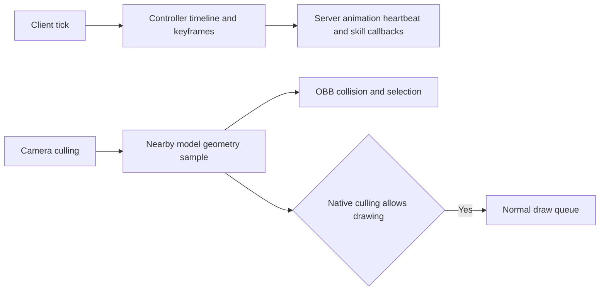
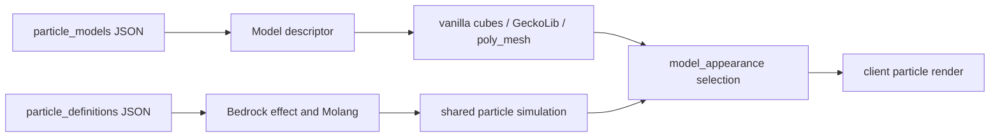

# Kltyton Bedrock Runtime

<p align="center"></p>

[English](README.md) | [简体中文](README.zh-CN.md)

A Minecraft library for GeckoLib model geometry: animation graphs, Tree/Baked model declarations, authored `poly_mesh` geometry, and model-derived oriented bounding boxes (OBBs) with part selection, combat/collision events, per-part state, model-based block shapes, and GeckoLib keyframe skills. The same client runtime loads Bedrock particle definitions with Molang expressions and model particles backed by vanilla cubes, GeckoLib geometry, or `poly_mesh` meshes.

## Target versions

| Minecraft | Library version | Loader | Java | GeckoLib | Target project |
| --- | --- | --- | --- | --- | --- |
| 26.2 | 0.4.0 | Fabric | 25 | 5.5.3 | [fabric-26.2](targets/fabric-26.2) |
| 26.2 | 0.4.0 | NeoForge | 25 | 5.5.3 | [neoforge-26.2](targets/neoforge-26.2) |
| 26.1.2 | 0.4.0 | Fabric | 25 | 5.5.2 | [fabric-26.1.2](targets/fabric-26.1.2) |
| 26.1.2 | 0.4.0 | NeoForge | 25 | 5.5.2 | [neoforge-26.1.2](targets/neoforge-26.1.2) |
| 1.21.1 | 0.4.0 | Fabric | 21 | 4.9.2 | [fabric-1.21.1](targets/fabric-1.21.1) |
| 1.21.1 | 0.4.0 | NeoForge | 21 | 4.9.2 | [neoforge-1.21.1](targets/neoforge-1.21.1) |
| 1.20.1 | 0.4.0 | Fabric | 17 | 4.8.4 | [fabric-1.20.1](targets/fabric-1.20.1) |
| 1.20.1 | 0.4.0 | Forge | 17 | 4.8.4 | [forge-1.20.1](targets/forge-1.20.1) |

All targets share the version-neutral code in `common/src/main` and select Minecraft- and loader-specific adapters from `common/src/compat`. Each `targets/<loader>-<minecraft>` directory is an independent Gradle project. Use matching Minecraft, loader and library builds on the client and server.

## Features

- **Model-derived entity geometry:** capture animated vanilla `ModelPart` cubes and GeckoLib cubes. Entities opt in through `BoneHitboxEntity`; selectors such as `ALL`, `BASE` and `HUMAN_BASE` choose actual model parts.
- **GeckoLib animation graphs:** immutable pose graphs with 1D/2D blend layouts, ordinary/additive/mask composition, and optional normalized quaternion Hermite transitions. Caller-supplied velocity inputs are typed separately from pose clips; graph evaluation does not advance native controllers or keyframe events.
- **Tree, Baked, and poly_mesh:** optional enhanced GeckoLib model declarations with a logical Tree path or certified static Baked groups, authored `poly_mesh` geometry, and exact mesh ray queries alongside the existing OBB selection/collision path.
- **Part selection and combat:** ray selection, highlights, mutable `ATTACK`, `HURT` and `COLLISION` attributes, contact events and per-part data such as health.
- **Collision and carrying:** `NONE`, `SOFT` and `HARD` policies, continuous OBB collision handling and support for carrying entities. Held-item geometry follows item bounds and hand/model transforms.
- **Server queries and synchronization:** `ObbServerGeometry` exposes recent model-pose snapshots, including transforms, axes, half extents and vertices. State and extension data can be synchronized and persisted.
- **GeckoLib keyframe skills:** point markers and `BEGIN/TICK/END/CANCEL` windows, tracked-entity timeline updates outside the camera frustum, and server-side report deduplication.
- **Model-based blocks:** choose OBB or AABB geometry, derive occupied cells from model elements, and link placement, removal and interaction across a multi-block structure.
- **Bedrock particles and model particles:** load `particle_definitions/*.json` effect definitions, evaluate their Molang expressions through the source-built mochafloats runtime, and render billboard particles or `model_appearance` model particles from vanilla cube models, GeckoLib geometry, or `poly_mesh` meshes.

## Installation

Use the JAR for your Minecraft version and loader. Put it in `mods/` on both sides where the library is required. Fabric also requires its matching Fabric API and Forge Config API Port. GeckoLib is required on every target; it is a host dependency and is not embedded. Install the matching GeckoLib version for your target.

The [version and Maven coordinate guide](docs/versions/README.md) lists all eight target artifacts. Build the matching target project to produce an installable JAR. Files ending in `-sources.jar` or `-javadoc.jar` are developer artifacts, not installable mods.

## Maven coordinates

Version `0.4.0` uses the `com.kltyton` Maven group. The common API module is `kltyton_bedrock_runtime-common-<minecraft>`; each loader module is `kltyton_bedrock_runtime-<loader>-<minecraft>`. The loader artifact is the runtime mod JAR, while the common artifact supplies compile-time API types. For NeoForge 26.2:

```groovy
repositories {
    maven {
        url = 'https://maven.sighs.cc/repository/maven-public/'
        content {
            includeModule 'com.kltyton', 'kltyton_bedrock_runtime-common-26.2'
            includeModule 'com.kltyton', 'kltyton_bedrock_runtime-neoforge-26.2'
        }
    }
}

dependencies {
    compileOnly 'com.kltyton:kltyton_bedrock_runtime-common-26.2:0.4.0'
    runtimeOnly 'com.kltyton:kltyton_bedrock_runtime-neoforge-26.2:0.4.0'
}
```

Replace `neoforge` and `26.2` with one of the loader/version pairs in the target table. The common API coordinate uses the same Minecraft version. These are the current `kltyton_bedrock_runtime` artifacts and the current `com.kltyton.bedrockruntime` package; the previous `bonehitboxlib-*` coordinates and `com.kltyton.bonehitboxlib` package are not provided as compatibility aliases.

## Entity integration

In 26.2, tracked GeckoLib controllers advance on client ticks while outside the camera view, and nearby culled models provide collision geometry through a separate deferred collector. Native distance and frustum checks use the sampled model bounds; sampled draw tasks never enter the normal draw queue. Frozen entities retain their paused animation state. Other target versions keep their previous behavior.



Implement `BoneHitboxEntity` and register the parts that participate. For example, the registration method can use:

```java
@Override
public void kltyton_bedrock_runtime$registerObbBones(ObbBoneRegistrar registrar) {
    registrar.register(ObbBoneRegistrar.ALL)
            .collision(ObbCollisionMode.HARD)
            .dataFactory(
                    ObbBoneRegistrar.BASE,
                    ObbBuiltinDataKeys.PART_HEALTH,
                    () -> new ObbPartHealth(20.0F, 20.0F))
            .data(ObbBuiltinDataKeys.CARRIES_ENTITIES, true);
    registrar.register("right_arm").attack();
}
```

Use the actual bone names in your model. `dataFactory(BASE, ...)` selects the base part within the registration; `data(...)` applies to all selected parts. The built-in player integration uses `HUMAN_BASE`, which includes the base and held items. See the [registration and synchronization API](docs/server_sync_api.md) for imports, events and state handling.

## Animation graphs

Implement `GraphAnimatable` on a normal GeckoLib animatable to opt into the graph extension:

```java
public final class ExampleGraphEntity implements GraphAnimatable {
    private final GraphDefinition graph = GraphDefinition.builder()
            .node(new GraphDefinition.AnimationNode("idle", "idle"))
            .output("idle")
            .build();

    @Override
    public GraphDefinition animationGraph() {
        return graph;
    }

    @Override
    public void captureGraphParameters(GraphRuntime runtime, Object related, float partialTick) {
        runtime.setParameter("speed", 0.0);
        // Optional Hermite velocities:
        // runtime.setVelocityInput("fromVelocity", callerOwnedVelocityPose);
    }
}
```

Graph nodes cover animation sampling, 1D/2D blends, ordinary `blend(base, input, weight)`, additive, mask, and Hermite transitions. Velocity inputs are a separate value kind: a `VelocityInputNode` is valid only for Hermite `fromVelocity`/`toVelocity`, with translation in pixels/second, rotation in parent-space radians/second, and scale ratio/second. `GraphRuntime.setVelocityInput` copies caller poses into owned storage; unset inputs mean zero velocity. Inline graph JSON is parsed by `GraphJsonParser` from a Java string or `JsonElement`; there is no automatic standalone graph-resource loader.

See [animation, model, and extension behavior](docs/animation/extensions.md) for node types, complete JSON, velocity lifecycle, and composition order, and [animation/model dependencies](docs/dependencies/animation-models.md) for target pins and attribution.

## Particles and model particles

The client particle runtime reads Bedrock effect definitions and model-particle descriptors from standard resource-pack paths:

```text
assets/<namespace>/particle_definitions/<id>.json
assets/<namespace>/particle_models/<id>.json
assets/<namespace>/models/<path>.json          # vanilla cube model used by a geometry descriptor
```

Both resource types are ordinary authored JSON, not generated files. A client resource reload (including `F3+T`) prepares definitions and descriptors off-thread and publishes them on the game thread. Billboard effects use the existing Bedrock component names such as `minecraft:emitter_rate_steady`, `minecraft:particle_lifetime_expression` and `minecraft:particle_appearance_billboard`. Molang strings are compiled and evaluated by the source-built mochafloats runtime; GeckoLib model and animation Molang stays on GeckoLib's own evaluation path.

A model particle opts in through the particle type and the appearance component:

```json
{
  "particle_effect": {
    "description": {
      "identifier": "examplemod:gem_dust",
      "type": "kltyton_bedrock_runtime:model_particle"
    },
    "components": {
      "kltyton_bedrock_runtime:model_appearance": {
        "size": [0.35, 0.35, 0.35],
        "facing_camera_mode": "lookat_xyz",
        "model": "examplemod:gem_dust_model"
      }
    }
  }
}
```

`examplemod:gem_dust_model` is the ID of a `particle_models/<id>.json` descriptor. Descriptor variants are `geometry` (vanilla cube model JSON), `geckolib` (baked GeckoLib model), `poly_mesh` (mesh carried by the project's enhanced GeckoLib model path), and `hardcode` (a registered vanilla `ModelLayerLocation`). The example descriptor below uses a self-authored vanilla cube model:

```json
{
  "variant": "geometry",
  "model_id": "examplemod:particle/gem_dust_model",
  "texture": "minecraft:particle/generic_1",
  "material": "cutout",
  "double_sided": false
}
```

The `model_id` path form resolves to `assets/examplemod/models/particle/gem_dust_model.json`. Textures use resource sprite IDs. Existing block/item atlas sprites are reused where suitable; other referenced images enter the model-particle atlas, including mip levels requested by the material and user setting. Programmatic geometry is registered through `ModelParticleModels.register(id, model)`; registrations survive resource reloads, while resource descriptors are replaced atomically. Register new programmatic textures before a resource reload.



The development examples add a billboard effect and a model particle under `examples/src/main/resources`; they are compiled only with `-Pdevelopment_examples` and are excluded from release JARs. In-game, an operator can preview loaded effects with:

```text
/kltyton_bedrock_runtime add kltyton_bedrock_runtime_examples:example_billboard ~ ~1 ~
/kltyton_bedrock_runtime add kltyton_bedrock_runtime_examples:example_model_particle ~ ~1 ~
```

A client-side Java caller can use the same option type through the normal particle path (26.2 identifier API shown):

```java
ClientLevel level = Minecraft.getInstance().level;
if (level != null) {
    level.addParticle(new MolangParticleOption(Identifier.fromNamespaceAndPath(
                    "kltyton_bedrock_runtime_examples", "example_billboard")),
            x, y, z, 0.0, 0.0, 0.0);
}
```

See [animation, model, and extension behavior](docs/animation/extensions.md#particle-runtime-and-model-particles) for the complete accepted fields and reload behavior.

## Block geometry configuration

Edit the loader-generated server configuration, `kltyton_bedrock_runtime-server.toml`:

```toml
vanillaSlantedBlockObb = true
forceAllBlockObb = false
blockModelWhitelist = []
blockModelBlacklist = []
```

- `vanillaSlantedBlockObb`: use packaged model geometry for vanilla slanted blocks; enabled by default.
- `forceAllBlockObb`: enable OBB collision for all allowed blocks; disabled by default. Prefer packaged model elements and fall back to the block's own finite collision geometry. Originally empty collision stays empty.
- `blockModelWhitelist`: an empty list imposes no restriction. A non-empty list limits the affected block IDs.
- `blockModelBlacklist`: takes priority over the whitelist, including forced mode and library model blocks. Excluded library model OBBs use model AABBs.

Lists accept `namespace:id`, `namespace:*` and `*`. For example:

```toml
forceAllBlockObb = true
blockModelWhitelist = ["minecraft:*"]
blockModelBlacklist = ["minecraft:chest", "minecraft:trapped_chest"]
```

The whitelist limits scope; it does not enable a mode by itself. See [block shapes](docs/block_shapes.md) for configuration locations, automatic multi-cell blocks and integration examples. In 26.2, `ModelShapeCache.buildForElements(JsonArray, Direction)` and its result types are public for consumers that already have model elements.

## Building

The root uses the KltytonTemple `3cfe9ad` controller. Each `targets/<loader>-<minecraft>` project has its own Gradle Wrapper and declares its Java toolchain. To build one target, run its wrapper from that directory:

```powershell
cd .\targets\neoforge-26.2
.\gradlew.bat build
```

From the repository root, the controller exposes per-target `build_<target>` tasks and `buildAllTargets`; target names replace `-` and `.` with `_`:

```powershell
.\gradlew.bat build_neoforge_26_2
.\gradlew.bat buildAllTargets
```

On Linux or macOS, use `./gradlew` in place of `gradlew.bat`. Build outputs are in each target's `build/libs/`. The build generates vanilla block geometry from the pinned Minecraft assets. Existing authored runtime models, animations, particle definitions, model-particle descriptors and textures remain regular resources; no DataGen step creates particle resources. Development examples are loaded only when a target is invoked with `-Pdevelopment_examples` and are excluded from release JARs.

## Operating boundaries

Entity poses and GeckoLib markers are client-assisted. The server validates tracking, registered keys, finite geometry, bounds and report budgets; integrations must authorize skills using their own server state. This is not a complete server-side animation simulation or anti-cheat system.

Block physics uses packaged model elements. Client resource packs, animated renderers and special rendering paths do not automatically redefine server collision. The packaged static model data does not describe shapes that change at runtime.

Bedrock particle simulation, Molang evaluation and model-particle rendering are client-side. The server command forwards an emitter request to selected viewers; it does not simulate particles or authorize gameplay effects. Model particles are visual objects and do not replace OBB collision or server hit validation.


## Documentation

- [English Wiki](https://github.com/kltyton/KltytonBedrockRuntime/wiki) · [中文 Wiki](https://github.com/kltyton/KltytonBedrockRuntime/wiki/Home.zh-CN)
- [Animation, model, particle, and extension behavior](docs/animation/extensions.md)
- [Animation, model, particle, and source dependencies](docs/dependencies/animation-models.md)
- [Registration, synchronization and events](docs/server_sync_api.md)
- [Client selection and highlights](docs/client_obb_selection.md)
- [Model-derived block shapes](docs/block_shapes.md)
- [Package layout and API migration](docs/package_layout.md)
- [Version and Maven coordinate guide](docs/versions/README.md)

## Acknowledgements

- **Eden Realm**: the implementation source for convex model geometry, cell clipping, automatic multi-cell placement, linked removal and interaction forwarding.
- **Mob Battle**: the reference for the GeckoLib keyframe reporting workflow.
- [Spark-Core](https://github.com/SolarMoonQAQ/Spark-Core): the design reference for separating logical animation updates from rendering. This library retains GeckoLib's animation evaluation and does not include Spark-Core's physics engine.
- [MAE](https://github.com/286799714/MaydayAnimationEngine) 1.1.4: MIT-licensed design and algorithm reference. Its notice is retained for attribution; MAE is not embedded or called as a runtime dependency.
- [ParticleStorm](https://github.com/westernat/ParticleStorm) 1.5.2 and [ThreeDimensionParticle](https://github.com/westernat/ThreeDimensionParticle) 1.2.1: LGPL-3.0-only design and implementation references for the Bedrock particle runtime and model-particle appearance. Their notices are retained; their editor assets and runtime JARs are not included.
- [mochafloats](https://github.com/PlayerAnimationLibrary/mochafloats) 6.1.1: MIT-licensed lexer, parser and interpreter used for particle Molang. Pinned sources are built for Java 17 under KBR's private class packages and module names. Original notices are retained; GeckoLib evaluates its own animation Molang.
- [GeckoLib](https://github.com/bernie-g/geckolib): a required host dependency for skeletal animation, model and keyframe integration; it is not embedded.
- [Fabric](https://fabricmc.net/), [NeoForge](https://neoforged.net/), [Minecraft Forge](https://minecraftforge.net/), [Forge Config API Port](https://github.com/Fuzss/forgeconfigapiport) and [MixinExtras](https://github.com/LlamaLad7/MixinExtras): loader, configuration and Mixin infrastructure.

Thanks to their authors and maintainers. Third-party project names and licenses belong to their respective owners.

## License

[LGPL-3.0-only](LICENSE).
