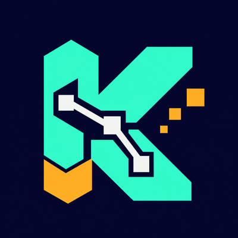
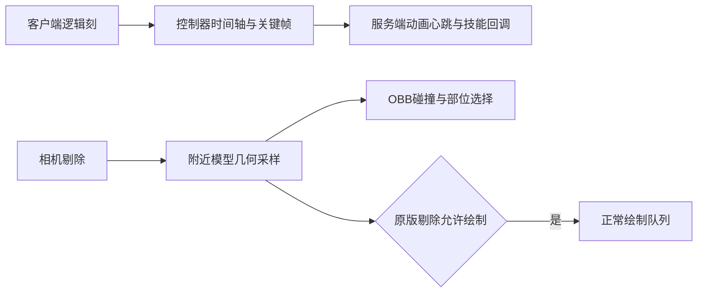
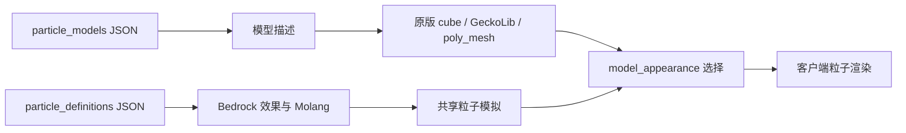

# Kltyton Bedrock Runtime

<p align="center"></p>

[English](README.md) | [简体中文](README.zh-CN.md)

面向 GeckoLib 模型几何的 Minecraft 库：提供动画图、Tree/Baked 模型声明、手写 `poly_mesh` 几何，以及由模型生成的有向包围盒（OBB）部位选择、战斗/碰撞事件、逐部位状态、模型方块形状和 GeckoLib 关键帧技能。客户端运行时还可加载带 Molang 表达式的 Bedrock 粒子定义，并渲染由原版 cube、GeckoLib 几何或 `poly_mesh` 网格驱动的模型粒子。

## 构建目标

| Minecraft | 库版本 | 加载器 | Java | GeckoLib | 目标工程 |
| --- | --- | --- | --- | --- | --- |
| 26.2 | 0.4.0 | Fabric | 25 | 5.5.3 | [fabric-26.2](targets/fabric-26.2) |
| 26.2 | 0.4.0 | NeoForge | 25 | 5.5.3 | [neoforge-26.2](targets/neoforge-26.2) |
| 26.1.2 | 0.4.0 | Fabric | 25 | 5.5.2 | [fabric-26.1.2](targets/fabric-26.1.2) |
| 26.1.2 | 0.4.0 | NeoForge | 25 | 5.5.2 | [neoforge-26.1.2](targets/neoforge-26.1.2) |
| 1.21.1 | 0.4.0 | Fabric | 21 | 4.9.2 | [fabric-1.21.1](targets/fabric-1.21.1) |
| 1.21.1 | 0.4.0 | NeoForge | 21 | 4.9.2 | [neoforge-1.21.1](targets/neoforge-1.21.1) |
| 1.20.1 | 0.4.0 | Fabric | 17 | 4.8.4 | [fabric-1.20.1](targets/fabric-1.20.1) |
| 1.20.1 | 0.4.0 | Forge | 17 | 4.8.4 | [forge-1.20.1](targets/forge-1.20.1) |

所有目标共享 `common/src/main` 中与版本和加载器无关的代码，并从 `common/src/compat` 选取 Minecraft 与加载器适配。每个 `targets/<loader>-<minecraft>` 目录都是独立 Gradle 工程。客户端与服务端应使用匹配的 Minecraft、加载器和库构建。

## 主要功能

- **实体模型几何**：采集动画后的原版 `ModelPart` cube 和 GeckoLib cube。实体通过 `BoneHitboxEntity` 显式接入；`ALL`、`BASE`、`HUMAN_BASE` 等选择器选取实际模型部位。
- **GeckoLib 动画图**：不可变姿态图支持一维/二维混合布局、普通/叠加/遮罩组合，以及可选的归一化四元数 Hermite 过渡。速度输入与姿态片段使用不同值类型；图求值不会推进原生控制器或触发关键帧事件。
- **Tree、Baked 与 poly_mesh**：可选增强 GeckoLib 模型声明，支持逻辑 Tree 路径或经认证的静态 Baked 组合、手写 `poly_mesh` 几何，以及和现有 OBB 选择/碰撞并行的精确网格射线查询。
- **部位选择与战斗**：射线选择、轮廓高亮，可修改的 `ATTACK`、`HURT`、`COLLISION` 属性，接触事件，以及生命值等逐部位数据。
- **碰撞与承载**：支持 `NONE`、`SOFT`、`HARD` 策略、连续 OBB 碰撞处理和实体承载。手持物几何跟随物品范围与手臂、模型变换。
- **服务端查询与同步**：`ObbServerGeometry` 提供近期模型姿态快照，包含变换、主轴、半尺寸和顶点；状态与扩展数据可同步和持久化。
- **GeckoLib 关键帧技能**：支持单点 marker 与 `BEGIN/TICK/END/CANCEL` 窗口，在视锥外推进已追踪实体的时间轴，并在服务端去重上报。
- **模型方块**：可选 OBB 或 AABB，由模型元素推导占位格，联动处理多格结构的放置、拆除与交互。
- **Bedrock 粒子与模型粒子：** 加载 `particle_definitions/*.json` 效果定义，通过源码内置的 mochafloats 运行时求值 Molang 表达式，并渲染 billboard 粒子或由原版 cube、GeckoLib 几何、`poly_mesh` 网格驱动的 `model_appearance` 模型粒子。

## 安装

选择匹配 Minecraft 版本和加载器的 JAR，放入需要此库的客户端与服务端 `mods/` 目录。Fabric 还需要匹配的 Fabric API 和 Forge Config API Port。所有目标都需要 GeckoLib；它是宿主依赖，不会随本库内嵌，请安装对应版本。

八个目标的发行模块见[版本与 Maven 坐标指南](docs/versions/README.zh-CN.md)。构建对应目标工程可得到安装包。`-sources.jar`、`-javadoc.jar` 是开发资料，不是可安装模组。

## Maven 坐标

0.4.0 使用 `com.kltyton` Maven 组。公共 API 模块为 `kltyton_bedrock_runtime-common-<minecraft>`；各加载器模块为 `kltyton_bedrock_runtime-<loader>-<minecraft>`。加载器产物是运行时模组 JAR，common 产物提供编译期 API 类型。以 NeoForge 26.2 为例：

```groovy
repositories {
    maven {
        url = 'https://maven.sighs.cc/repository/maven-public/'
        content {
            includeModule 'com.kltyton', 'kltyton_bedrock_runtime-common-26.2'
            includeModule 'com.kltyton', 'kltyton_bedrock_runtime-neoforge-26.2'
        }
    }
}

dependencies {
    compileOnly 'com.kltyton:kltyton_bedrock_runtime-common-26.2:0.4.0'
    runtimeOnly 'com.kltyton:kltyton_bedrock_runtime-neoforge-26.2:0.4.0'
}
```

其他目标替换为版本表中的加载器和 Minecraft 版本；common API 坐标使用相同的 Minecraft 版本。 这些坐标是当前的 `kltyton_bedrock_runtime` 产物和 `com.kltyton.bedrockruntime` 包；不提供 `bonehitboxlib-*` 旧坐标或 `com.kltyton.bonehitboxlib` 旧包作为兼容别名。

## 实体接入

26.2 中，已追踪 GeckoLib 实体在视野外仍按客户端逻辑刻推进控制器与关键帧；附近被剔除的模型通过独立延迟收集器提供碰撞几何，原版距离与视锥判断使用采集的模型边界，采样绘制任务不进入正常绘制队列。冻结实体保留动画暂停语义。其他目标版本保持原有行为。



实现 `BoneHitboxEntity` 并注册参与处理的部位，例如：

```java
@Override
public void kltyton_bedrock_runtime$registerObbBones(ObbBoneRegistrar registrar) {
    registrar.register(ObbBoneRegistrar.ALL)
            .collision(ObbCollisionMode.HARD)
            .dataFactory(
                    ObbBoneRegistrar.BASE,
                    ObbBuiltinDataKeys.PART_HEALTH,
                    () -> new ObbPartHealth(20.0F, 20.0F))
            .data(ObbBuiltinDataKeys.CARRIES_ENTITIES, true);
    registrar.register("right_arm").attack();
}
```

请使用模型中真实的骨骼名称。`dataFactory(BASE, ...)` 选择当前注册中的基础部位；`data(...)` 作用于所有选中部位。内置玩家接入使用包含基础部位和手持物的 `HUMAN_BASE`。导入、事件和状态管理见[注册与同步 API](docs/server_sync_api.md)。

## 动画图

在普通 GeckoLib 实体上实现 `GraphAnimatable` 即可显式启用动画图：

```java
public final class ExampleGraphEntity implements GraphAnimatable {
    private final GraphDefinition graph = GraphDefinition.builder()
            .node(new GraphDefinition.AnimationNode("idle", "idle"))
            .output("idle")
            .build();

    @Override
    public GraphDefinition animationGraph() {
        return graph;
    }

    @Override
    public void captureGraphParameters(GraphRuntime runtime, Object related, float partialTick) {
        runtime.setParameter("speed", 0.0);
        // 可选 Hermite 速度：
        // runtime.setVelocityInput("fromVelocity", callerOwnedVelocityPose);
    }
}
```

图节点覆盖动画采样、一维/二维混合、普通 `blend(base, input, weight)`、叠加、遮罩和 Hermite 过渡。速度输入是独立值类型：`VelocityInputNode` 只能用于 Hermite 的 `fromVelocity`/`toVelocity`；平移单位为像素/秒，旋转为父空间弧度/秒，缩放为比例/秒。`GraphRuntime.setVelocityInput` 会把调用方姿态复制到运行时自有存储；未设置即显式零速度。内联图 JSON 由 `GraphJsonParser` 从 Java 字符串或 `JsonElement` 解析，目前没有自动独立图资源加载器。

节点类型、完整 JSON、速度生命周期和组合顺序见[动画、模型与扩展行为](docs/animation/extensions.md)；目标版本与归属说明见[动画/模型依赖](docs/dependencies/animation-models.md)。

## 粒子与模型粒子

客户端粒子运行时从标准资源包路径读取 Bedrock 效果定义和模型粒子描述文件：

```text
assets/<namespace>/particle_definitions/<id>.json
assets/<namespace>/particle_models/<id>.json
assets/<namespace>/models/<path>.json          # geometry 描述文件使用的原版 cube 模型
```

这些文件都是手写普通资源，不经过 DataGen。客户端资源重载（包括 `F3+T`）会在后台准备定义和描述文件，再于游戏线程发布。Billboard 效果使用现有 Bedrock 组件名，例如 `minecraft:emitter_rate_steady`、`minecraft:particle_lifetime_expression` 和 `minecraft:particle_appearance_billboard`。Molang 字符串由源码重建的 mochafloats 运行时编译和求值；GeckoLib 的模型与动画 Molang 仍由 GeckoLib 自身引擎处理。

模型粒子通过粒子类型和外观组件显式启用：

```json
{
  "particle_effect": {
    "description": {
      "identifier": "examplemod:gem_dust",
      "type": "kltyton_bedrock_runtime:model_particle"
    },
    "components": {
      "kltyton_bedrock_runtime:model_appearance": {
        "size": [0.35, 0.35, 0.35],
        "facing_camera_mode": "lookat_xyz",
        "model": "examplemod:gem_dust_model"
      }
    }
  }
}
```

`examplemod:gem_dust_model` 指向 `particle_models/<id>.json` 描述文件。描述文件的 `variant` 可取 `geometry`（原版 cube 模型 JSON）、`geckolib`（已烘焙 GeckoLib 模型）、`poly_mesh`（增强 GeckoLib 模型路径携带的网格）和 `hardcode`（已注册的原版 `ModelLayerLocation`）。下面的示例使用自制原版 cube 模型：

```json
{
  "variant": "geometry",
  "model_id": "examplemod:particle/gem_dust_model",
  "texture": "minecraft:particle/generic_1",
  "material": "cutout",
  "double_sided": false
}
```

`model_id` 的路径形式会解析到 `assets/examplemod/models/particle/gem_dust_model.json`。`texture` 使用资源 sprite ID。适用时复用原版方块、物品图集，其他实际引用的图片进入模型粒子图集，并按材质和用户设置生成 mip。客户端可通过 `ModelParticleModels.register(id, model)` 注册程序化模型；注册在重载后保留，资源描述文件整体替换。新增程序化贴图应在资源重载前注册。



开发示例在 `examples/src/main/resources` 下增加了 billboard 效果和模型粒子；只有使用 `-Pdevelopment_examples` 时才会编译，且不会进入发行 JAR。游戏中可由管理员预览已加载效果：

```text
/kltyton_bedrock_runtime add kltyton_bedrock_runtime_examples:example_billboard ~ ~1 ~
/kltyton_bedrock_runtime add kltyton_bedrock_runtime_examples:example_model_particle ~ ~1 ~
```

客户端 Java 调用方可沿用普通粒子路径使用同一选项类型（下例为 26.2 标识符 API）：

```java
ClientLevel level = Minecraft.getInstance().level;
if (level != null) {
    level.addParticle(new MolangParticleOption(Identifier.fromNamespaceAndPath(
                    "kltyton_bedrock_runtime_examples", "example_billboard")),
            x, y, z, 0.0, 0.0, 0.0);
}
```

完整字段和重载行为见[动画、模型与扩展行为](docs/animation/extensions.md#particle-runtime-and-model-particles)。

## 方块几何配置

编辑加载器生成的服务端配置 `kltyton_bedrock_runtime-server.toml`：

```toml
vanillaSlantedBlockObb = true
forceAllBlockObb = false
blockModelWhitelist = []
blockModelBlacklist = []
```

- `vanillaSlantedBlockObb`：原版斜面方块使用已打包的模型几何，默认开启。
- `forceAllBlockObb`：为允许范围内的所有方块启用 OBB 碰撞，默认关闭。优先使用已打包模型元素，缺失时使用方块自身的有限碰撞几何；原本为空的碰撞保持为空。
- `blockModelWhitelist`：空列表不限制范围；非空时仅允许匹配的方块 ID。
- `blockModelBlacklist`：优先于白名单，同样约束强制模式与本库模型方块；被排除的本库模型 OBB 使用模型 AABB。

列表支持 `namespace:id`、`namespace:*` 和 `*`，例如：

```toml
forceAllBlockObb = true
blockModelWhitelist = ["minecraft:*"]
blockModelBlacklist = ["minecraft:chest", "minecraft:trapped_chest"]
```

白名单仅限制范围，不会自行开启几何模式。配置位置、自动多格方块和接入示例见[方块形状](docs/block_shapes.md)。26.2 公开了 `ModelShapeCache.buildForElements(JsonArray, Direction)` 及其结果类型，供已持有模型元素的调用方复用。

## 构建

根工程使用 KltytonTemple `3cfe9ad` 控制器。每个 `targets/<loader>-<minecraft>` 工程都有自己的 Gradle Wrapper，并声明目标 Java 工具链。单独构建一个目标时，在目标目录运行 Wrapper：

```powershell
cd .\targets\neoforge-26.2
.\gradlew.bat build
```

从仓库根目录也可通过控制器的 `build_<target>` 任务构建单个目标，或用 `buildAllTargets` 构建全部八个目标；目标名中的 `-` 和 `.` 会替换为 `_`：

```powershell
.\gradlew.bat build_neoforge_26_2
.\gradlew.bat buildAllTargets
```

Linux 或 macOS 使用 `./gradlew` 替代 `gradlew.bat`。产物位于各目标的 `build/libs/`。构建从锁定的 Minecraft 资源生成原版方块几何；已有手写或编辑器导出的运行时模型、动画和贴图仍作为普通资源维护。  粒子定义、模型粒子描述文件和贴图同样作为普通资源维护，不经过 DataGen。仅在目标使用 `-Pdevelopment_examples` 时加载开发示例，且示例不会进入发行 JAR。

## 运行边界

实体姿态和 GeckoLib marker 由客户端辅助提供。服务端验证追踪关系、注册键、有限几何、范围和上报预算；接入方仍须根据自己的服务端状态授权技能。这不构成完整的服务端动画模拟或反作弊系统。

方块物理使用已打包的模型元素。客户端资源包、动画渲染器和特殊渲染流程不会自动改变服务端碰撞。这份静态模型数据不描述运行时变化的形状。


Bedrock 粒子模拟、Molang 求值和模型粒子渲染都在客户端进行。服务端命令只把发射器请求转发给选定玩家，不模拟粒子，也不授权玩法效果。模型粒子属于视觉对象，不替代 OBB 碰撞或服务端命中校验。

## 文档

- [中文 Wiki](https://github.com/kltyton/KltytonBedrockRuntime/wiki/Home.zh-CN) · [English Wiki](https://github.com/kltyton/KltytonBedrockRuntime/wiki)
- [动画、模型、粒子与扩展行为](docs/animation/extensions.md)
- [动画、模型、粒子与来源依赖](docs/dependencies/animation-models.md)
- [注册、同步与事件](docs/server_sync_api.md)
- [客户端选择与高亮](docs/client_obb_selection.md)
- [模型方块形状](docs/block_shapes.md)
- [包结构与 API 迁移](docs/package_layout.md)
- [版本与 Maven 坐标指南](docs/versions/README.zh-CN.md)

## 鸣谢

- **Eden Realm**：模型凸几何、按格裁切、自动多格放置、联动拆除和交互转发的实现来源。
- **Mob Battle**：GeckoLib 关键帧上报流程的参考。
- [Spark-Core（星火核心）](https://github.com/SolarMoonQAQ/Spark-Core)：逻辑动画更新与渲染分离的设计参考。本库沿用 GeckoLib 的动画计算流程，不包含 Spark-Core 的物理引擎。
- [MAE](https://github.com/286799714/MaydayAnimationEngine) 1.1.4：MIT 许可的设计与算法参考。保留其声明用于归属说明；MAE 不作为运行时依赖内嵌或调用。
- [ParticleStorm](https://github.com/westernat/ParticleStorm) 1.5.2 与 [ThreeDimensionParticle](https://github.com/westernat/ThreeDimensionParticle) 1.2.1：Bedrock 粒子运行时和模型粒子外观的 LGPL-3.0-only 设计与实现参考。保留其声明；不包含其编辑器资产或运行时 JAR。
- [mochafloats](https://github.com/PlayerAnimationLibrary/mochafloats) 6.1.1：用于粒子 Molang 的 MIT 许可词法、语法与解释器。锁定源码以 Java 17 为目标构建到 KBR 私有类包和模块名，保留原始许可声明。GeckoLib 动画 Molang 由自身引擎计算。
- [GeckoLib](https://github.com/bernie-g/geckolib)：骨骼动画、模型及关键帧集成的必需宿主依赖，不随本库内嵌。
- [Fabric](https://fabricmc.net/)、[NeoForge](https://neoforged.net/)、[Minecraft Forge](https://minecraftforge.net/)、[Forge Config API Port](https://github.com/Fuzss/forgeconfigapiport) 和 [MixinExtras](https://github.com/LlamaLad7/MixinExtras)：加载器、配置和 Mixin 基础设施。

感谢以上项目的作者与维护者。第三方项目的名称与许可归各自权利人所有。

## 许可证

[LGPL-3.0-only](LICENSE)。
