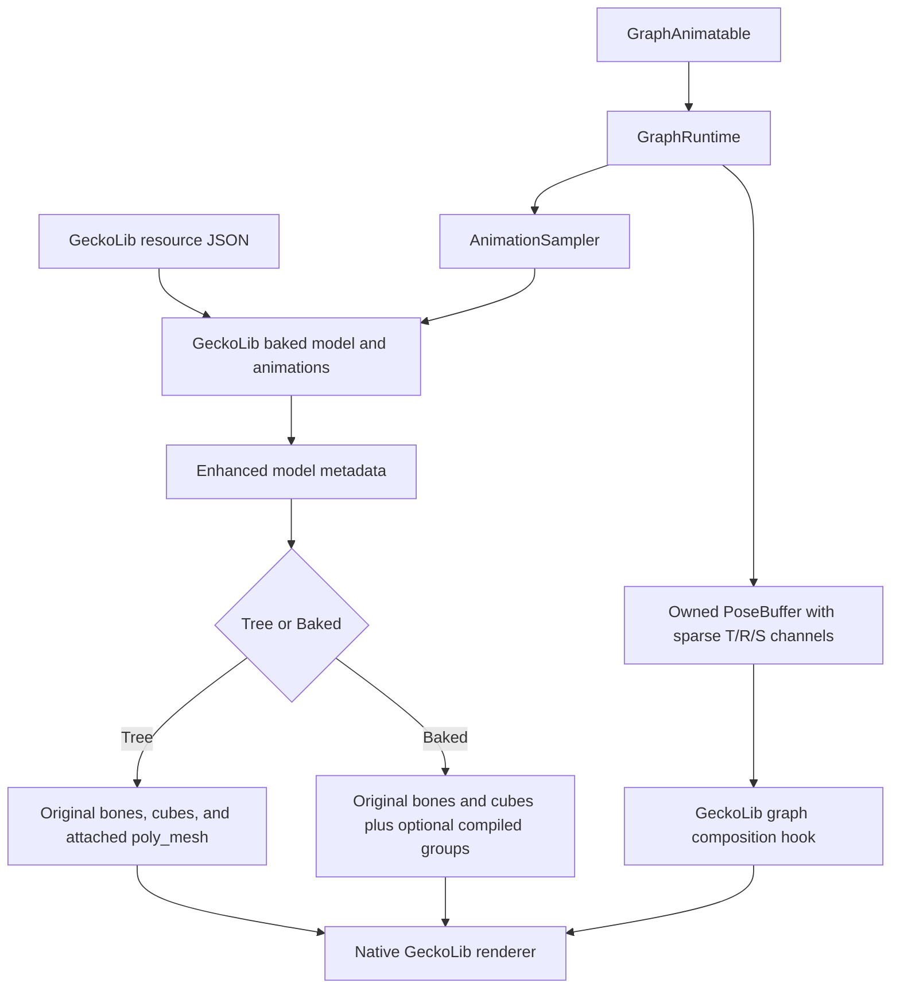
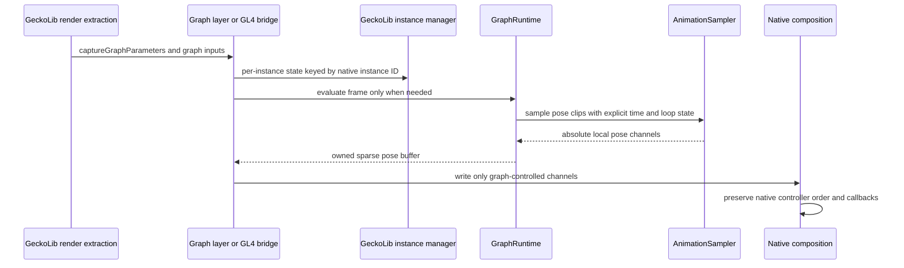

# Animation, Model, and Extension Behavior

This page describes the current model/geometry and animation-graph contracts for the GeckoLib 4 and GeckoLib 5 targets. It covers Tree/Baked model declarations, authored `poly_mesh` geometry, exact mesh rays, and the opt-in animation-graph extension. GeckoLib remains a host dependency; it is not embedded.

## Architecture



Tree mode keeps the native bone tree, cubes, locators, and animation data. Baked mode may additionally compile explicitly certified static groups into merged meshes. Compilation is optional; a group that fails its static, consumer, or runtime checks stays on the original GeckoLib path.

## Ownership flow



The graph owns its reusable node buffers, frame output, bindings, and caller-supplied velocity copies. It does not advance native controllers, mutate native `AnimationPoint` index arrays, or emit keyframe events. Game state is captured before graph evaluation; native controller timelines and keyframe handlers remain authoritative.

GeckoLib 4 instance state also carries a `GraphWorldBinding`. The current client level is captured only at the immediate `handleAnimations` bridge point; its world reference is weak, and the instance is rebuilt when the current client world no longer matches. This avoids reusing replaced-entity, singleton, or reused item-ID instance state across worlds without strongly retaining an unloaded world. Rebuilding creates fresh graph parameters, velocity copies, and frame caches. The shared skeleton-binding cache remains resource/model based and is not wiped. GeckoLib 5 samplers release captured render state, query maps, and clip maps after the frame pose has been copied.

## Model definition layer

The neutral model core is split by responsibility:

| Package | Types |
| --- | --- |
| `model.definition` | `ModelGeometry`, `ModelBone`, `ModelGeometryPart`, `ModelLocator`, `ModelGeometryBuilder` |
| `model.pose` | `ModelPose` |
| `model.binding` | `ModelConsumer`, `ModelConsumers` |
| `model.optimization` | `ModelOptimizer`, `OptimizationOptions`, `OptimizationPlan`, `OptimizationResult`, `StaticGroup`, `CompiledModelPlan`, `CompiledGroup`, `CompiledModelPlanner` |
| `model.resource` | `EnhancedModelData` |

`ModelGeometry` and `EnhancedModelData` are immutable resource-time values. `ModelPose` is per-instance runtime state.

```java
import com.kltyton.bedrockruntime.api.model.EnhancedModels;
import com.kltyton.bedrockruntime.geometry.mesh.TriangleMesh;
import com.kltyton.bedrockruntime.model.definition.ModelGeometry;
import com.kltyton.bedrockruntime.model.definition.ModelGeometryBuilder;
import com.kltyton.bedrockruntime.model.pose.ModelPose;
import com.kltyton.bedrockruntime.model.resource.EnhancedModelData;

import org.joml.Matrix4f;
import org.joml.Vector3f;

String resource = "examplemod:geo/example.geo.json";
EnhancedModelData data = EnhancedModels.registerResource(resource, MyMod.class);
TriangleMesh mesh = data.meshes().get("head");

ModelGeometryBuilder builder = new ModelGeometryBuilder(resource, true);
builder.addBone("root", null, new Matrix4f(), new Vector3f());
builder.addBone("head", "root", new Matrix4f(), new Vector3f(0.0F, 24.0F, 0.0F));
builder.addPart("head", "geckolib:default", mesh, new Matrix4f());
ModelGeometry geometry = builder.build();

ModelPose pose = ModelPose.bind(geometry)
        .withLocalTransform("head", new Matrix4f().translate(0.0F, 1.0F, 0.0F));
```

## Tree and Baked declarations

The optional `kltyton_bedrock_runtime` object in a `.geo.json` file is read by `EnhancedModelData.parse`:

```json
{
  "kltyton_bedrock_runtime": {
    "format_version": 1,
    "model_mode": "baked",
    "static_bones": ["cape", "skirt"],
    "preserve_bones": ["cape"],
    "double_sided": true
  }
}
```

- `format_version`: currently `1`.
- `model_mode`: `tree` (default) or `baked`.
- `static_bones`: bones explicitly certified as static for compilation.
- `preserve_bones`: bones that must remain on the original logical path.
- `double_sided`: emitted mesh faces use the double-sided path; it does not change global culling state.

Current compilation rules:

- Compilation requires `model_mode: "baked"` and non-empty `static_bones`.
- `preserve_bones` and registered consumer references block affected groups.
- Groups need at least two geometry-bearing bones under the same top static ancestor.
- Cube and `poly_mesh` geometry on the same bone are represented in the same native render-pass material.
- Baked mode does not remove logical bones, locators, cubes, capture data, or native animation channels.

Consumers are declared before the model is baked:

```java
import com.kltyton.bedrockruntime.api.model.EnhancedModels;
import com.kltyton.bedrockruntime.model.binding.ModelConsumer;
import com.kltyton.bedrockruntime.model.binding.ModelConsumers;

EnhancedModels.registerConsumers(resource, ModelConsumers.builder()
        .add(ModelConsumer.ANIMATION, "head")
        .add(ModelConsumer.BONE_MASK, "cape")
        .add(ModelConsumer.PER_BONE_CALLBACK, "weapon_hand")
        .build());
```

Available categories are `ANIMATION`, `PROCEDURAL`, `BONE_MASK`, `LOCATOR`, `HELD_ITEM`, `ARMOR`, `PER_BONE_CALLBACK`, and `HITBOX_NAME`.

## GeckoLib 4 geometry sharing

On the GeckoLib 4 targets (`1.20.1`, `1.21.1`), the enhanced geometry loader and model attachment classes live in the shared legacy source package under `client.compat.geckolib.loading` and `client.compat.geckolib.model`.

- The model-bake hook always calls the original GeckoLib `BakedModelFactory` exactly once.
- Enhanced metadata is attached to the original baked bones; the original model remains the render model.
- Optional compiled geometry decorates those current bones; there is no namespace-wide factory takeover.
- The poly_mesh reader uses a resource-local Gson clone with the corrected `PolyMesh` adapter while preserving the original Gson operation and native `PolyMesh` data.

On GeckoLib 5 targets, the native `CubePolyIndex` parser cannot represent standard polygons. The root loader therefore parses the full `poly_mesh` extension first and passes a mesh-free copy to the native cube/locator baker. The raw resource is unchanged and the full geometry remains available to the enhanced model data.

## poly_mesh parsing and exact rays

`BedrockMeshParser` converts `poly_mesh` data into an immutable `TriangleMesh`:

- Positions are finite, mirrored on X, and divided by 16; they remain absolute bone/model coordinates.
- Independent position, normal, and UV indices are validated.
- UVs are normalized when `normalized_uvs` is true; otherwise they are divided by texture width/height. After normalization the mesh uses the SimpleBedrockModel convention `v = 1 - v`. `normalized_uvs` defaults to false; set it explicitly when the authored UVs are already in 0..1.
- Normals are normalized; missing or zero normals use the triangle face normal.
- Polygon input must be a simple, planar polygon without holes or self-intersections.
- Concave polygons use ear clipping. Index lists, `tri_list`, and `quad_list` are supported.
- Degenerate, non-finite, nonplanar, self-intersecting, or unsupported polygons fail with resource/bone diagnostics.

When an `ObbGeometry` carries a `TriangleMesh`, segment queries use `MeshRayQuery`/`TriangleMesh.rayIntersection` for the exact selected mesh. Movement collision remains the OBB path: SAT overlap and continuous sweep are not replaced by mesh collision.

## Particle runtime and model particles

The client particle runtime shares the eight target builds and reads ordinary resource-pack JSON. The same paths are used by 1.20.1, 1.21.1, 26.1.2 and 26.2:

```text
assets/<namespace>/particle_definitions/<id>.json
assets/<namespace>/particle_models/<id>.json
assets/<namespace>/models/<path>.json
```

`particle_definitions` files contain one `particle_effect` object. `particle_models` files are descriptors; a `geometry` descriptor resolves its `model_id` path to the normal model JSON path. Neither type is generated by DataGen, and the runtime does not require the donor particle editor or its example assets.

### Effect definitions

`description.identifier` is required. `description.basic_render_parameters` supplies `material` and `texture`; `description.type` is the registered particle type and defaults to `kltyton_bedrock_runtime:molang`. The components map uses the registered component IDs from `ParticleRegistry`, for example `minecraft:emitter_rate_steady`, `minecraft:emitter_lifetime_looping`, `minecraft:emitter_shape_sphere`, `minecraft:particle_lifetime_expression`, `minecraft:particle_initial_speed`, `minecraft:particle_motion_dynamic`, and `minecraft:particle_appearance_billboard`. Optional `curves` and `events` maps keep the existing Bedrock semantics.

Molang expressions in component, curve and event fields are compiled and evaluated by the pinned mochafloats source modules. Those modules are rebuilt for Java 17 from the 6.1.1 sources with KBR's particle-specific dialect, numeric operators, contextual scope and structured control flow patches. GeckoLib animation and model Molang remains on GeckoLib's own evaluator; KBR does not replace native GeckoLib controllers, keyframes or animation expressions.

The particle dialect supports `%` and `^` through the same contextual evaluator as its ordinary operators. Array indexing and truth conversion use that scope as well. `math.die_roll` retains floating-point bounds. For the two-bound forms of `math.random_integer` and `math.die_roll_integer`, the inclusive integer range is `ceil(min(low, high))` through `floor(max(low, high))`; a requested draw fails with a diagnostic if that range contains no finite integer. Zero dice still sum to zero. / 粒子方言的 `%` 与 `^` 和普通运算共用上下文解释器，数组下标与真假转换也使用同一作用域。`math.die_roll` 保留浮点边界。双边界整数随机函数在 `ceil(min(low, high))` 至 `floor(max(low, high))` 的闭区间采样；需要采样而区间不含有限整数时报告错误，零次掷骰仍返回零。

### Model-particle descriptors

A descriptor is loaded into the model registry under both its file ID and its `model_id`:

```json
{
  "variant": "geometry",
  "model_id": "examplemod:particle/gem_dust_model",
  "texture": "minecraft:particle/generic_1",
  "material": "cutout",
  "double_sided": false
}
```

- `variant`: `geometry` (vanilla cube model JSON), `geckolib` (baked GeckoLib model), `poly_mesh` (baked GeckoLib model plus its enhanced mesh data), or `hardcode` (a vanilla `ModelLayerLocation`). Missing or unknown values resolve to `geometry`. The GeckoLib-backed variants require the referenced model to be available in the baked-model cache at reload time; the `hardcode` variant requires the model layer to be registered.
- `model_id`: required. For `geometry`, `examplemod:particle/gem` reads `assets/examplemod/models/particle/gem.json`; an explicit `.json` path is also accepted. For `hardcode`, append `#layer` to select a non-default model layer.
- `texture`: particle-atlas sprite ID.
- `material`: `solid`, `cutout`, `cutout_mipped` or `translucent`; unknown values fall back to `solid`.
- `double_sided`: applies to emitted faces.

A model particle selects its descriptor through `description.type` and the model appearance component:

```json
{
  "description": {
    "identifier": "examplemod:gem_dust",
    "type": "kltyton_bedrock_runtime:model_particle"
  },
  "components": {
    "kltyton_bedrock_runtime:model_appearance": {
      "size": [0.35, 0.35, 0.35],
      "facing_camera_mode": "lookat_xyz",
      "model": "examplemod:gem_dust_model"
    }
  }
}
```

`model_appearance` accepts `size` (three Molang values), optional `face_camera_mode`/`facing_camera_mode`, optional `direction`, optional `model_animation`, and optional `model`. `model_animation` supports `type_frames` (a model ID, an array of weighted model choices, or frame arrays), `frames_per_second`, `stretch_to_lifetime`, and `loop`. When `model` is present, that single descriptor is used; otherwise `type_frames` selects a model per frame. The component identifier is `kltyton_bedrock_runtime:model_appearance`; the particle type identifier is `kltyton_bedrock_runtime:model_particle`. The old `thr_dim_particle` namespace is not registered as an alias.

The model ID is resolved lazily against the current registry. Resource descriptors are published as one immutable snapshot on the game thread after the background parse, so an F3+T reload replaces descriptors and geometry without retaining old resource state. Programmatic registrations made through `ModelParticleModels.register(id, model)` survive resource reloads.

### Public client API

Resource-driven effects can be spawned through the normal particle option path. On 26.x:

```java
ClientLevel level = Minecraft.getInstance().level;
if (level != null) {
    level.addParticle(new MolangParticleOption(Identifier.fromNamespaceAndPath(
                    "examplemod", "gem_dust")),
            x, y, z, 0.0, 0.0, 0.0);
}
```

Programmatic model geometry uses the public `client.particle.model.api` package:

```java
ModelParticleModels.register("examplemod:programmatic_model",
        new ModelParticleModel("examplemod:programmatic_model",
                "examplemod:particle/gem_dust",
                List.of(new ModelParticlePart(
                        "examplemod:particle/gem_dust",
                        ModelMaterial.CUTOUT,
                        ModelUvSpace.NORMALIZED,
                        mesh,
                        new Matrix4f())),
                ModelMaterial.CUTOUT,
                false));
```

`mesh` is an immutable `TriangleMesh` built with `TriangleMeshBuilder`; the same API also accepts a `ModelParticleSource` for lazy resolution. `BedrockModelParticles` exposes the registered type, `modelParticleType()`, the type ID, `modelParticleId()`, `modelAppearanceId()`, and the reload listener. Registration and spawning are client-side operations.

`BedrockModelParticles.initialize()` registers the `model_appearance` component and the `model_particle` provider through `ParticleEvents`; loader wiring registers the particle type before client resources load and registers `reloadListener()` with the client resource manager. Custom components, event nodes, particle types and model materials use the same `ParticleEvents` registration events.

### Particle preview

An operator can preview an effect already loaded from a resource pack by its ID:

```text
/kltyton_bedrock_runtime add <namespace>:<effect_id> ~ ~1 ~
```

## Animation graphs

`GraphAnimatable` is an explicit client-side opt-in. The animatable remains a normal GeckoLib animatable.

```java
import com.kltyton.bedrockruntime.animation.graph.GraphDefinition;
import com.kltyton.bedrockruntime.animation.graph.GraphRuntime;
import com.kltyton.bedrockruntime.api.animation.GraphAnimatable;

public final class ExampleGraphEntity implements GraphAnimatable {
    private final GraphDefinition graph = GraphDefinition.builder()
            .node(new GraphDefinition.AnimationNode("idle", "idle"))
            .output("idle")
            .build();

    @Override
    public GraphDefinition animationGraph() {
        return graph;
    }

    @Override
    public void captureGraphParameters(GraphRuntime runtime, Object related, float partialTick) {
        runtime.setParameter("speed", 0.0);
    }
}
```

`GraphRuntime.evaluate(frameId, seconds, binding, sampler)` returns a runtime-owned `PoseBuffer`. Pose channels are sparse: a node owns only the translation, rotation, or scale channels it writes. Native and programmatic channels not written by the graph remain untouched.

### Node value kinds

`GraphDefinition` distinguishes two node value kinds:

| Kind | Nodes | Use |
| --- | --- | --- |
| `POSE` | animation, blend, additive, mask, Hermite output | Local pose data |
| `VELOCITY` | `VelocityInputNode` | Hermite endpoint velocity |

A `VelocityInputNode` may only be referenced by a Hermite node’s `fromVelocity` or `toVelocity` field. It cannot be the graph output or feed an ordinary animation, blend, additive, mask, or Hermite `from`/`to` field. Existing graphs that omit velocity references remain valid; omitted velocity inputs mean zero velocity.

### Velocity inputs

Velocity values are supplied by the caller through the runtime:

```java
int root = binding.indexOf("root");

PoseBuffer fromVelocity = new PoseBuffer(binding);
fromVelocity.setRotation(root, 0.0F, 1.5F, 0.0F); // parent-space rad/s

runtime.setVelocityInput("transitionFrom", fromVelocity);
runtime.setVelocityInput("transitionTo", toVelocity);
```

- Translation velocity is pixels per second.
- Rotation velocity is parent-space angular velocity in radians per second.
- Scale velocity is ratio per second.
- Sparse channel flags mean zero velocity for absent channels.
- `setVelocityInput` copies into a runtime-owned reusable buffer; the caller may reuse or mutate its own buffer after the call.
- `clearVelocityInput` and `clearVelocityInputs` remove explicit inputs. Unset inputs evaluate as explicit zero velocity.
- Binding or generation changes migrate compatible velocity copies or drop incompatible ones. No frame-history estimation or stale velocity cache is used.

### JSON v1

```json
{
  "version": 1,
  "parameters": {"blend": 0.0, "phase": 0.75},
  "output": "transition",
  "nodes": {
    "idle": {"type": "animation", "animation": "idle", "time": "loop"},
    "walk": {"type": "animation", "animation": "walk", "time": "loop"},
    "locomotion": {
      "type": "blend1d",
      "parameter": "blend",
      "entries": [
        {"position": 0.0, "node": "idle"},
        {"position": 1.0, "node": "walk"}
      ]
    },
    "fromVelocity": {"type": "velocity_input", "input": "transitionFrom"},
    "toVelocity": {"type": "velocity_input", "input": "transitionTo"},
    "transition": {
      "type": "hermite",
      "from": "locomotion",
      "to": "idle",
      "fromVelocity": "fromVelocity",
      "toVelocity": "toVelocity",
      "duration": 0.25,
      "phaseParameter": "phase"
    }
  }
}
```

`velocity_input` accepts `input` (canonical) or `key` as the caller-owned input key. Supplying both is rejected. The JSON parser reports node references, value-kind mismatches, cycles, and field errors with paths such as `$.nodes.transition.fromVelocity`.

Supported node types:

| Type | Main fields |
| --- | --- |
| `animation` | `animation`, `time` (`absolute`, `loop`, `phase`), `speed`, `offset`, `duration`, `loop` |
| `blend1d` | `parameter`, `entries[]` with `position`, `node` |
| `blend2d` | `parameterX`, `parameterY`, `entries[]` with `x`, `y`, `node` |
| `blend` | `base`, `input`, `weight` or `weightParameter` |
| `additive` | `base`, `additive`, `weight` or `weightParameter` |
| `hermite` / `transition` | pose `from`, pose `to`, optional `fromVelocity`/`toVelocity`, `duration`, `phase` or `phaseParameter` |
| `mask` | `node`, `weight` in `[0,1]`, `names`, `indices`, or `subtrees` |
| `velocity_input` | `input` or `key` |

Enhanced model resources may include the graph under `kltyton_bedrock_runtime.graph`. `EnhancedModelData` exposes it as `graph : Optional<GraphDefinition>`, and `EnhancedModels.graph(String fullAssetId)` resolves the current client graph for the full asset id. The client resolver is installed by `Loader.register` and reads the current baked model data (the GeckoLib 5 wrapper or GeckoLib 4 `MeshGeoBone.modelData`), so a GeckoLib native F3+T reload keeps the model and graph coherent without a standalone resource listener. The MESH/Zombie example getters use `EnhancedModels.graph(modelResource)`; the other scenes keep Java graph definitions.

`GraphJsonParser` remains available for standalone Java/string or caller-managed JSON parsing. The enhanced-model inline graph is the automatic resource path; there is still no separate standalone graph-file loader.

### Sampling and time flow

- Animation-node local time is `offset + seconds * speed`; `loop` wraps, `phase` converts the fractional part to clip time, and `absolute` passes time through.
- `AnimationSampler.duration(String)` supplies actual clip duration for phase sampling when available.
- Pose translation is in GeckoLib model position units (pixels), rotation is radians in ZYX order, and scale is a multiplier.
- Ordinary blend uses the host JOML shortest-path quaternion interpolation (`q`/`-q` handling).
- Additive nodes convert absolute child poses to bind-relative deltas before Euler-additive composition: rotation subtracts skeleton bind Euler angles, translation keeps position units, and scale keeps its ratio.
- Hermite transitions use a normalized four-dimensional quaternion Hermite curve. Parent-space angular rates feed `dq/dt = 0.5 * (omega, 0) * q`; translation and scale are Hermite-interpolated component-wise.
- A zero-duration Hermite transition resolves instantly to the target pose. Non-finite or cancelling rotation tangents are rejected explicitly. No automatic velocity estimator or frame-history sampling is used.

### Composition order

GeckoLib 5 targets:

- The graph layer captures game queries and caller state during `addRenderData`.
- Its owned graph frame is evaluated lazily for the render pass and reused by the composition hook; the layer does not sample unless the pass requests it.
- `GeckoGraphCompositionMixin` inserts the graph before the first native additive `createBoneSnapshots` operation, or after the last native operation when no additive controller exists.
- Every native `createBoneSnapshots` call is still invoked exactly once, in its original order, with the original callback chain.
- Java-side model-bone adjustment remains after graph composition.

GeckoLib 4 targets:

- `GeckoGraphAnimationMixin` applies the graph at `GeoModel.handleAnimations` RETURN, after native controller processing and `setCustomAnimations`.
- The graph writes only its sparse channels to the native bones.
- On 1.20.1, a narrow `LazyVariableAccessor` restores the original Molang `anim_time` supplier without runtime reflection.

## Version adapters

- GeckoLib 4.8.4 (`1.20.1`): shared legacy geometry loader/model attachment plus `software.bernie.geckolib` animation adapters. `BakedGeoModel` is a record, `GeoBone` is mutable, and instance state is guarded by `GraphWorldBinding` with a weak world reference.
- GeckoLib 4.9.2 (`1.21.1`): same GeckoLib 4 adapter family and world guard with the 1.21 vertex API.
- GeckoLib 5.5.2 (`26.1.2`) and 5.5.3 (`26.2`): `com.geckolib` render-state, backend bone-snapshot composition, and the graph layer/composition mixin.

The eight target pins are unchanged. Exact dependency versions remain locked by target metadata for version-specific hooks. The adapters preserve native cubes, locators, logical bone names, controller callbacks, and capture/query data.
