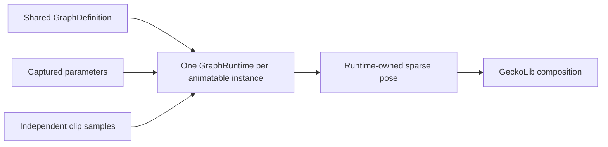

# Animation graphs

[English](https://github.com/kltyton/KltytonBedrockRuntime/wiki/Animation-Graphs) | [简体中文](https://github.com/kltyton/KltytonBedrockRuntime/wiki/Animation-Graphs.zh-CN) · [Home](https://github.com/kltyton/KltytonBedrockRuntime/wiki/Home)

An animation graph samples existing GeckoLib clips and combines their poses. Add `GraphAnimatable` to the animatable class already used by GeckoLib. Keep its existing controllers, renderer and keyframe handlers.

## 1D movement blending in Java

The following definition is shareable. The clip IDs `idle`, `walk` and `run` must exist in your normal GeckoLib animation file.

```java
import com.kltyton.bedrockruntime.animation.graph.GraphDefinition;
import java.util.List;

public final class LocomotionGraph {
    public static final GraphDefinition DEFINITION = GraphDefinition.builder()
            .defaultParameter("speed", 0.0)
            .node(new GraphDefinition.AnimationNode("idle", "idle"))
            .node(new GraphDefinition.AnimationNode("walk", "walk"))
            .node(new GraphDefinition.AnimationNode("run", "run"))
            .node(new GraphDefinition.Blend1DNode("movement", "speed", List.of(
                    new GraphDefinition.Blend1DEntry(0.0F, "idle"),
                    new GraphDefinition.Blend1DEntry(2.0F, "walk"),
                    new GraphDefinition.Blend1DEntry(6.0F, "run"))))
            .output("movement")
            .build();

    private LocomotionGraph() { }
}
```

Inside your existing GeckoLib entity, implement `GraphAnimatable` and add:

```java
@Override
public GraphDefinition animationGraph() {
    return LocomotionGraph.DEFINITION;
}

@Override
public void captureGraphParameters(
        GraphRuntime runtime, Object relatedObject, float partialTick) {
    runtime.setParameter("speed", getDeltaMovement().horizontalDistance() * 20.0);
}
```

Import `GraphAnimatable` from `com.kltyton.bedrockruntime.api.animation`, and `GraphDefinition` / `GraphRuntime` from `com.kltyton.bedrockruntime.animation.graph`. The example uses horizontal blocks per second; choose sample positions that match the authored gait.

A 1D layout sorts sample positions, mixes adjacent samples and clamps beyond the endpoints. Duplicate or non-finite positions are rejected. Runtime layouts and pose buffers are reused.

## 2D graphs in JSON

Place this object in the model's top-level `kltyton_bedrock_runtime.graph` property. The five animation IDs refer to existing clips.

```json
{
  "version": 1,
  "parameters": {"sideways": 0.0, "forward": 0.0},
  "output": "movement",
  "nodes": {
    "idle": {"type": "animation", "animation": "idle", "time": "loop"},
    "front": {"type": "animation", "animation": "walk_forward", "time": "loop"},
    "back": {"type": "animation", "animation": "walk_backward", "time": "loop"},
    "left": {"type": "animation", "animation": "walk_left", "time": "loop"},
    "right": {"type": "animation", "animation": "walk_right", "time": "loop"},
    "movement": {
      "type": "blend2d",
      "parameterX": "sideways",
      "parameterY": "forward",
      "entries": [
        {"x": 0.0, "y": 0.0, "node": "idle"},
        {"x": 0.0, "y": 1.0, "node": "front"},
        {"x": 0.0, "y": -1.0, "node": "back"},
        {"x": -1.0, "y": 0.0, "node": "left"},
        {"x": 1.0, "y": 0.0, "node": "right"}
      ]
    }
  }
}
```

Capture the two parameters from your movement or aiming logic. Resolve an inline graph through `EnhancedModels.graph(fullModelResourceId)` in `animationGraph()`; see [Models](https://github.com/kltyton/KltytonBedrockRuntime/wiki/Models). `GraphJsonParser` is also available for caller-managed JSON. KBR's automatic graph-resource path is the inline model property.

The 2D layout triangulates once. Outside its convex hull, queries clamp to the nearest hull edge. Collinear points use a deterministic line projection; one sample produces that sample. Empty layouts, duplicate points and non-finite coordinates are rejected.

## Bone masks and layered weighting

A mask can target names, explicit indices and complete subtrees. Build a mask for the current `SkeletonBinding` and rebuild it when that binding changes.

For a rig containing `waist`, `left_shoulder`, `right_shoulder`, `left_arm` and `right_arm`:

```java
BoneMask upperBody = BoneMask.builder(binding)
        .setDefault(0.0F)
        .subtree("waist", 0.25F)
        .subtree("left_shoulder", 0.75F)
        .subtree("right_shoulder", 0.75F)
        .subtree("left_arm", 1.0F)
        .subtree("right_arm", 1.0F)
        .build();

PoseBlender.lerpMasked(locomotion, aim, upperBody, 1.0F, output);
```

These types are in `com.kltyton.bedrockruntime.animation.pose`. The pose arguments must use the same binding. Unselected bones retain `locomotion` in this operation.

Later `set`/`subtree` calls overwrite earlier weights; `add`/`addSubtree` accumulate and clamp at one. A missing bone name is an error with skeleton context, so use your real rig names.

Graph JSON `mask` nodes select a contribution with `names`, `indices` and/or `subtrees`, plus `weight`. `additive` nodes convert absolute child poses into bind-relative deltas before composing them. Ordinary pose replacement and additive layering have different neutral values; use the operation that matches the authored clip.

## Nodes and time

| Type | Role |
| --- | --- |
| `animation` | Sample a GeckoLib clip |
| `blend1d` / `blend2d` | Continuous parameter-driven blend |
| `blend` | Ordinary blend of `base` and `input` |
| `additive` | Bind-relative contribution over `base` |
| `mask` | Named/indexed/subtree contribution selection |
| `hermite` / `transition` | Pose transition with explicit duration and phase |
| `velocity_input` | Caller-supplied endpoint velocity for Hermite |

`absolute` uses the explicit local clock, `loop` wraps looping clips, and `phase` interprets the fractional part of `offset + seconds * speed` as a normalized phase using clip duration. Keep phase-related clip speeds and offsets consistent when they share a cycle. Blending does not automatically apply root motion or remove foot sliding.

## Hermite transitions

A Hermite node uses pose references `from`/`to` and optional velocity references `fromVelocity`/`toVelocity`. `phaseParameter` selects a captured parameter, such as a transition progress from 0 to 1.

```json
{
  "type": "hermite",
  "from": "movement",
  "to": "aim",
  "fromVelocity": "startVelocity",
  "toVelocity": "endVelocity",
  "duration": 0.25,
  "phaseParameter": "transitionProgress"
}
```

Define the velocity nodes with `{"type":"velocity_input","input":"transitionFrom"}` and supply their poses through `GraphRuntime.setVelocityInput`. Translation velocity is model pixels/second, rotation velocity is parent-space radians/second, and scale velocity is ratio/second. Inputs are copied; omitted inputs mean zero velocity. Clear or replace supplied velocities when your transition, seek or reset changes their meaning. Zero duration resolves to the target pose.

## Ownership and pose semantics



Positions use GeckoLib model pixels; rotation channels use radians with ZYX composition; scales are multipliers. For interpolation, an absent translation/scale channel has neutral 0/1 and an absent rotation uses the bind rotation. A graph output only writes channels it owns.

Do not retain a runtime-owned output after the next evaluation, share a runtime between entities, or store instance clocks on shared bones. Capture game data in `captureGraphParameters`. Graph sampling does not fire sound, particle or custom keyframe events; native GeckoLib handlers remain responsible.

See the [full extension reference](https://github.com/kltyton/KltytonBedrockRuntime/blob/main/docs/animation/extensions.md) for value-kind validation, composition order and velocity lifetime details.
