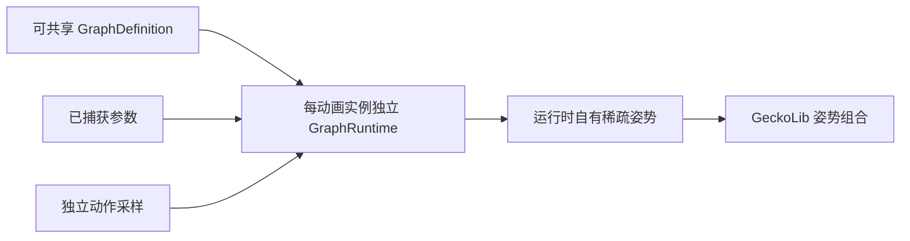

# 动画图

[English](https://github.com/kltyton/KltytonBedrockRuntime/wiki/Animation-Graphs) | [简体中文](https://github.com/kltyton/KltytonBedrockRuntime/wiki/Animation-Graphs.zh-CN) · [首页](https://github.com/kltyton/KltytonBedrockRuntime/wiki/Home.zh-CN)

动画图采样已有 GeckoLib 动画片段并组合姿势。给 GeckoLib 已经驱动的动画对象实现 `GraphAnimatable`，保留原有控制器、渲染器及关键帧处理器。

## Java：按速度做 1D 混合

图定义可以共享。`idle`、`walk`、`run` 必须对应普通 GeckoLib 动画文件中已有的动作 ID。

```java
import com.kltyton.bedrockruntime.animation.graph.GraphDefinition;
import java.util.List;

public final class LocomotionGraph {
    public static final GraphDefinition DEFINITION = GraphDefinition.builder()
            .defaultParameter("speed", 0.0)
            .node(new GraphDefinition.AnimationNode("idle", "idle"))
            .node(new GraphDefinition.AnimationNode("walk", "walk"))
            .node(new GraphDefinition.AnimationNode("run", "run"))
            .node(new GraphDefinition.Blend1DNode("movement", "speed", List.of(
                    new GraphDefinition.Blend1DEntry(0.0F, "idle"),
                    new GraphDefinition.Blend1DEntry(2.0F, "walk"),
                    new GraphDefinition.Blend1DEntry(6.0F, "run"))))
            .output("movement")
            .build();

    private LocomotionGraph() { }
}
```

在已有 GeckoLib 实体中实现 `GraphAnimatable`，加入以下覆写：

```java
@Override
public GraphDefinition animationGraph() {
    return LocomotionGraph.DEFINITION;
}

@Override
public void captureGraphParameters(
        GraphRuntime runtime, Object relatedObject, float partialTick) {
    runtime.setParameter("speed", getDeltaMovement().horizontalDistance() * 20.0);
}
```

`GraphAnimatable` 位于 `com.kltyton.bedrockruntime.api.animation`；`GraphDefinition`、`GraphRuntime` 位于 `com.kltyton.bedrockruntime.animation.graph`。此例参数单位为水平格/秒，采样点应按动作原本的步速设置。

1D 布局会排序采样点，在相邻点间混合，越过边界时夹取端点。重复点与非有限坐标会报错。布局和姿势缓存由运行实例复用。

## JSON：二维方向混合

将下面的对象放入模型顶层的 `kltyton_bedrock_runtime.graph`。五个动作 ID 仍引用已有动画片段。

```json
{
  "version": 1,
  "parameters": {"sideways": 0.0, "forward": 0.0},
  "output": "movement",
  "nodes": {
    "idle": {"type": "animation", "animation": "idle", "time": "loop"},
    "front": {"type": "animation", "animation": "walk_forward", "time": "loop"},
    "back": {"type": "animation", "animation": "walk_backward", "time": "loop"},
    "left": {"type": "animation", "animation": "walk_left", "time": "loop"},
    "right": {"type": "animation", "animation": "walk_right", "time": "loop"},
    "movement": {
      "type": "blend2d",
      "parameterX": "sideways",
      "parameterY": "forward",
      "entries": [
        {"x": 0.0, "y": 0.0, "node": "idle"},
        {"x": 0.0, "y": 1.0, "node": "front"},
        {"x": 0.0, "y": -1.0, "node": "back"},
        {"x": -1.0, "y": 0.0, "node": "left"},
        {"x": 1.0, "y": 0.0, "node": "right"}
      ]
    }
  }
}
```

在移动或瞄准逻辑中捕获两个参数。使用 `EnhancedModels.graph(完整模型资源ID)` 在 `animationGraph()` 中读取内联图，见[模型](https://github.com/kltyton/KltytonBedrockRuntime/wiki/Models.zh-CN)。`GraphJsonParser` 也可供使用方自行解析 JSON；自动资源接入路径是模型内联属性。

2D 布局只在创建时三角化。凸包外输入投影到最近的凸包边；共线点采用确定的线投影，单采样点直接输出该点。空布局、重复点和非有限坐标会报错。

## 骨骼遮罩与分层权重

遮罩可以按名称、显式索引或整棵子树指定权重。为当前 `SkeletonBinding` 构建遮罩，并在绑定发生变化时重建。

假设骨架具有 `waist`、`left_shoulder`、`right_shoulder`、`left_arm` 和 `right_arm`：

```java
BoneMask upperBody = BoneMask.builder(binding)
        .setDefault(0.0F)
        .subtree("waist", 0.25F)
        .subtree("left_shoulder", 0.75F)
        .subtree("right_shoulder", 0.75F)
        .subtree("left_arm", 1.0F)
        .subtree("right_arm", 1.0F)
        .build();

PoseBlender.lerpMasked(locomotion, aim, upperBody, 1.0F, output);
```

这些类型位于 `com.kltyton.bedrockruntime.animation.pose`。姿势参数必须使用相同绑定；此操作让未选中的骨骼保留 `locomotion`，腰部、肩部和手臂分别采用上面设置的混合程度。

后面的 `set`/`subtree` 覆盖前面的权重；`add`/`addSubtree` 累加并限制在 1。不存在的骨骼名会带骨架上下文报错，应使用实际模型命名。

JSON 的 `mask` 节点通过 `names`、`indices`、`subtrees` 和 `weight` 选择动作贡献；`additive` 会先把绝对局部子姿势转换成相对 bind pose 的增量再组合。普通覆盖和增量叠加的单位值不同，应按动作的制作方式选择。

## 节点与时间

| 类型 | 职责 |
| --- | --- |
| `animation` | 采样 GeckoLib 动画片段 |
| `blend1d` / `blend2d` | 连续参数混合 |
| `blend` | 普通混合 `base` 与 `input` |
| `additive` | 在 `base` 上加入 bind-relative 贡献 |
| `mask` | 按名称、索引或子树选择贡献 |
| `hermite` / `transition` | 显式时长和相位的姿势过渡 |
| `velocity_input` | 为 Hermite 提供调用方速度 |

`absolute` 使用显式局部时钟；`loop` 循环采样；`phase` 把 `offset + seconds * speed` 的小数部分解释为归一化相位，再乘动作长度。多个循环动作共享周期时，应统一相位相关的速度和偏移。姿势混合不自动应用 root motion，也不会自行消除滑步。

## Hermite 过渡

Hermite 使用 `from`/`to` 姿势引用，以及可选的 `fromVelocity`/`toVelocity` 速度引用。`phaseParameter` 指向捕获的过渡进度，例如从 0 到 1 的参数。

```json
{
  "type": "hermite",
  "from": "movement",
  "to": "aim",
  "fromVelocity": "startVelocity",
  "toVelocity": "endVelocity",
  "duration": 0.25,
  "phaseParameter": "transitionProgress"
}
```

速度节点使用 `{"type":"velocity_input","input":"transitionFrom"}`，通过 `GraphRuntime.setVelocityInput` 提供姿势数据。平移速度为模型像素/秒，旋转速度为父空间弧度/秒，缩放速度为比例/秒。输入会被复制；未提供的速度视为零。在转场、seek 或重置改变速度含义时，清除或替换输入。零时长直接采用目标姿势。

## 数据所有权与姿势语义



位移使用 GeckoLib 模型像素；旋转通道使用弧度并按 ZYX 组合；缩放是倍率。插值时，缺失位移/缩放的单位值为 0/1，缺失旋转采用 bind rotation。图输出只覆盖自己拥有的通道。

不要跨下一次求值保留运行时自有输出，不要跨实体共享运行实例，也不要把实例时钟存入共享骨骼。在 `captureGraphParameters` 中捕获游戏状态。姿势采样不会派发声音、粒子或自定义关键帧事件；这些仍由原生 GeckoLib handler 负责。

值类型校验、组合顺序和速度生命周期详见[完整扩展说明](https://github.com/kltyton/KltytonBedrockRuntime/blob/main/docs/animation/extensions.md)。
