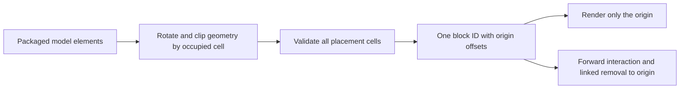

# Block geometry

[English](https://github.com/kltyton/KltytonBedrockRuntime/wiki/Block-Geometry) | [简体中文](https://github.com/kltyton/KltytonBedrockRuntime/wiki/Block-Geometry.zh-CN) · [Home](https://github.com/kltyton/KltytonBedrockRuntime/wiki/Home)

The advanced automatic model-block APIs on this page target **Minecraft 26.2, Fabric and NeoForge**. They read packaged Java block-model `elements` and prepare server-safe shapes. Use the target's API rather than copying imports to another Minecraft version.

## Choose AABB or OBB

```java
Identifier model = Identifier.fromNamespaceAndPath("examplemod", "block/slanted_prop");
ModelShapeProvider.prepare(model);
VoxelShape detailed = ModelShapeProvider.shape(
        model, Direction.NORTH, BlockShapeMode.OBB);
VoxelShape axisAligned = ModelShapeProvider.shape(model, BlockShapeMode.AABB);
```

`ModelShapeProvider` and `BlockShapeMode` are in `com.kltyton.bedrockruntime.api.block.shape`. The other types are the 26.2 native `Identifier`, `Direction` and `VoxelShape`.

Run preparation during registration/setup. Return the prepared shape from the block's normal shape/collision methods.

- OBB preserves the rotated convex geometry.
- AABB encloses that geometry with native axis-aligned bounds.
- Shape queries read prepared data; rendering callbacks and movement queries do not parse model files.

## Automatic multi-block structures

Use your loader's normal block and BlockItem registration. After assigning the properties their correct registry key, construct:

```java
AutoModelBlock block = new AutoModelBlock(blockId, properties, BlockShapeMode.OBB);
```

`AutoModelBlock` shows the selected occupied cell's outline; `AutoWholeModelBlock` shows the whole structure. Subclass `AutoPartShapeBlock` / `AutoWholeShapeBlock` when you need custom origin interaction, placement, block entities or drops.



The model convention is `assets/<namespace>/models/block/<block path>.json`. One registered block ID represents the structure; state offsets identify the origin. Placement checks the occupied cells, world boundaries, replaceability and entity obstruction.

Each axis may extend at most four cells from the origin; model coordinates are clipped to the supported `[-4, 5]` block interval. Prepare models within those bounds.

`AutoShapeDataProvider` can generate the automatic blocks' orientation/origin blockstates and item definitions through your existing data-generation entrypoint. Original model JSON, textures, language files and loot remain authored by your mod.

## Server configuration

Edit the loader-generated `kltyton_bedrock_runtime-server.toml`:

```toml
vanillaSlantedBlockObb = true
forceAllBlockObb = false
blockModelWhitelist = []
blockModelBlacklist = []
```

| Setting | Behavior |
| --- | --- |
| `vanillaSlantedBlockObb` | Use packaged model geometry for native slanted models |
| `forceAllBlockObb` | Enable the model OBB path for allowed blocks; default false |
| `blockModelWhitelist` | Empty means unrestricted; a nonempty list restricts eligibility |
| `blockModelBlacklist` | Exclusions take priority over the whitelist |

Entries support `namespace:id`, `namespace:*` and `*`. Block tags and arbitrary-position wildcards are not supported. A whitelist restricts scope; it does not enable a mode by itself.

```toml
forceAllBlockObb = true
blockModelWhitelist = ["minecraft:*"]
blockModelBlacklist = ["minecraft:chest", "minecraft:trapped_chest"]
```

For forced mode, KBR uses packaged model elements where available and the block's own finite collision pieces otherwise. Originally empty collision stays empty. The lists also apply to KBR model OBBs; excluded model geometry uses its model AABB path.

Client resource packs, animated renderers and visual model overrides do not automatically change the server's block-physics model.

## Parsing existing element arrays

The 26.2 API also exposes `ModelShapeCache.buildForElements(JsonArray, Direction)` and its `ShapeSet`/`Cell` results for callers that already hold model elements.

See the [block-shape reference](https://github.com/kltyton/KltytonBedrockRuntime/blob/main/docs/block_shapes.md) for provider registration, origin hooks and detailed configuration behavior.
