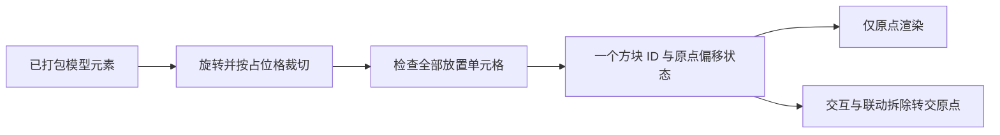

# 方块几何

[English](https://github.com/kltyton/KltytonBedrockRuntime/wiki/Block-Geometry) | [简体中文](https://github.com/kltyton/KltytonBedrockRuntime/wiki/Block-Geometry.zh-CN) · [首页](https://github.com/kltyton/KltytonBedrockRuntime/wiki/Home.zh-CN)

本页高级自动模型方块 API 对应 **Minecraft 26.2、Fabric 与 NeoForge**。它读取已打包 Java 方块模型的 `elements`，准备可供服务端使用的形状。其他版本应采用对应目标的 API，不直接照搬导入。

## 选择 AABB 或 OBB

```java
Identifier model = Identifier.fromNamespaceAndPath("examplemod", "block/slanted_prop");
ModelShapeProvider.prepare(model);
VoxelShape detailed = ModelShapeProvider.shape(
        model, Direction.NORTH, BlockShapeMode.OBB);
VoxelShape axisAligned = ModelShapeProvider.shape(model, BlockShapeMode.AABB);
```

`ModelShapeProvider`、`BlockShapeMode` 位于 `com.kltyton.bedrockruntime.api.block.shape`。其他类型是 26.2 原生的 `Identifier`、`Direction`、`VoxelShape`。

在注册/初始化阶段预处理，再从方块的正常选择/碰撞形状方法返回预备形状。

- OBB 保留旋转后的凸几何。
- AABB 用原版轴对齐包围范围包住几何。
- 查询阶段只读已准备的数据，不在渲染回调或运动查询中解析模型文件。

## 自动多格结构

使用加载器正常的方块与 BlockItem 注册流程。为属性设置正确注册键后构造：

```java
AutoModelBlock block = new AutoModelBlock(blockId, properties, BlockShapeMode.OBB);
```

`AutoModelBlock` 显示准星所在占位格的局部轮廓，`AutoWholeModelBlock` 显示整体轮廓。需要自定义原点交互、放置、方块实体或掉落时，继承 `AutoPartShapeBlock` / `AutoWholeShapeBlock`。



模型约定为 `assets/<namespace>/models/block/<block path>.json`。整个结构只注册一个方块 ID，状态中的偏移标识原点；放置会检查占位格、世界边界、可替换状态和实体阻挡。

每轴相对原点最多偏移四格，模型坐标裁剪到支持的 `[-4, 5]` 格区间，应在此范围内制作模型。

`AutoShapeDataProvider` 可通过已有数据生成入口，生成自动方块的朝向/原点 blockstate 和物品定义。原始模型 JSON、贴图、语言和掉落仍由自己的模组维护。

## 服务端配置

编辑加载器生成的 `kltyton_bedrock_runtime-server.toml`：

```toml
vanillaSlantedBlockObb = true
forceAllBlockObb = false
blockModelWhitelist = []
blockModelBlacklist = []
```

| 配置 | 行为 |
| --- | --- |
| `vanillaSlantedBlockObb` | 对原版斜面模型采用已打包几何 |
| `forceAllBlockObb` | 为允许的方块启用模型 OBB 路径，默认关闭 |
| `blockModelWhitelist` | 空列表不限制，非空时限制适用范围 |
| `blockModelBlacklist` | 优先于白名单的排除项 |

条目支持 `namespace:id`、`namespace:*` 和 `*`，不支持方块标签或任意位置通配符。白名单只限制范围，不会自己开启模式。

```toml
forceAllBlockObb = true
blockModelWhitelist = ["minecraft:*"]
blockModelBlacklist = ["minecraft:chest", "minecraft:trapped_chest"]
```

强制模式优先使用已打包的模型元素；没有可用元素时使用方块自身有限碰撞分片。原本为空的碰撞仍为空。名单也约束 KBR 模型 OBB，被排除的模型几何采用模型 AABB 路径。

客户端资源包、动画渲染器或视觉模型覆盖不会自动改变服务端方块物理模型。

## 解析已有元素数组

26.2 还公开 `ModelShapeCache.buildForElements(JsonArray, Direction)` 及 `ShapeSet`、`Cell` 结果，供已持有模型元素的调用方使用。

Provider 注册、原点 hooks 和详细配置行为见[方块形状参考](https://github.com/kltyton/KltytonBedrockRuntime/blob/main/docs/block_shapes.md)。
