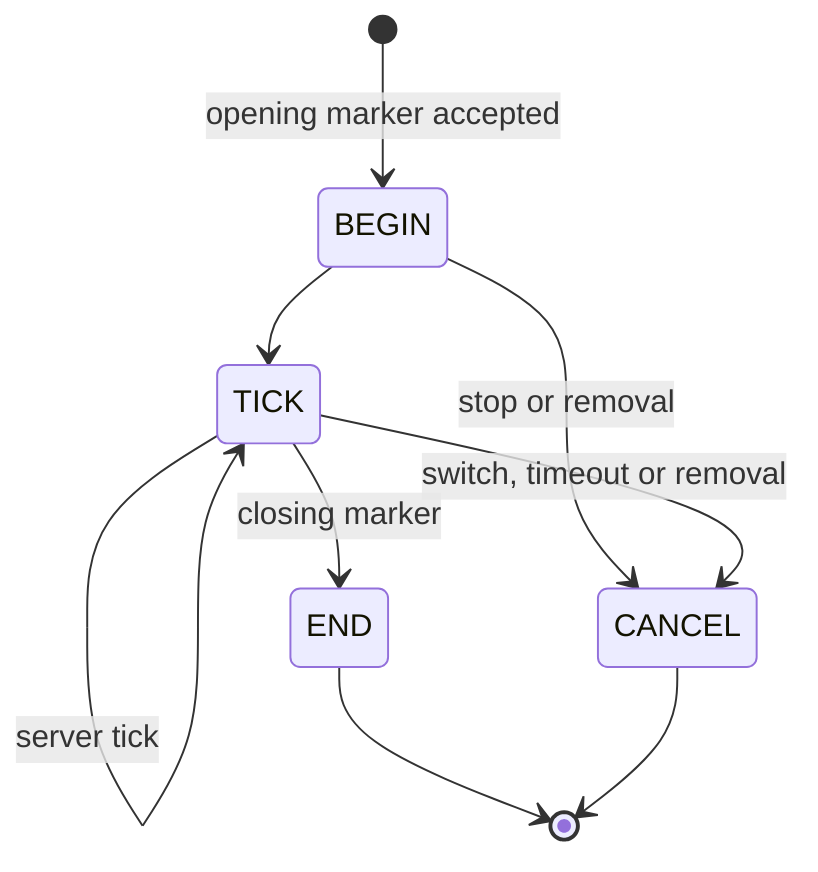

# Part selection, collision and events

[English](https://github.com/kltyton/KltytonBedrockRuntime/wiki/Collision-and-Events) | [简体中文](https://github.com/kltyton/KltytonBedrockRuntime/wiki/Collision-and-Events.zh-CN) · [Home](https://github.com/kltyton/KltytonBedrockRuntime/wiki/Home)

KBR derives geometry from registered model parts. Registration identifies which parts participate; it does not require manually authoring every OBB dimension.

## Register an entity's parts

Implement `com.kltyton.bedrockruntime.api.entity.BoneHitboxEntity` on the entity and override its registration method. Inside that existing entity class:

```java
@Override
public void kltyton_bedrock_runtime$registerObbBones(ObbBoneRegistrar registrar) {
    registrar.register(ObbBoneRegistrar.ALL)
            .dataFactory(
                    ObbBoneRegistrar.ALL,
                    ObbBuiltinDataKeys.PART_HEALTH,
                    () -> new ObbPartHealth(20.0F, 20.0F));
    registrar.register("right_arm")
            .attack()
            .collision(ObbCollisionMode.HARD);
}
```

Imports:

| Type | Package |
| --- | --- |
| `ObbBoneRegistrar` | `com.kltyton.bedrockruntime.api.registration.registrar` |
| `ObbCollisionMode` | `com.kltyton.bedrockruntime.api.bone.collision` |
| `ObbBuiltinDataKeys` | `com.kltyton.bedrockruntime.api.data.builtin.key` |
| `ObbPartHealth` | `com.kltyton.bedrockruntime.api.data.builtin.health` |

Use real bone names. `ALL` selects all captured parts, `BASE` selects standard humanoid body parts, and `HUMAN_BASE` also includes held items. The built-in player integration uses `HUMAN_BASE`; other entities register their own parts. An empty registration is an error.

`dataFactory` creates an independent value for each selected part. In the example, each part gets its own health object; the right arm additionally opts into attack contact and hard collision.

## Attributes and collision policies

`ATTACK`, `HURT` and `COLLISION` are composable attributes. They are not exclusive hitbox types.

| Collision mode | Meaning |
| --- | --- |
| `NONE` | Contacts/events without physical response |
| `SOFT` | Push response |
| `HARD` | OBB movement clipping and contact response |

Runtime bone state can change permanent or named temporary attributes. Release temporary scopes when the action ends or is canceled.

```java
ObbBoneState bone = entity.kltyton_bedrock_runtime$obbBone(key).orElseThrow();
bone.setTemporaryAttackBox("examplemod:slash", true);
bone.setTemporaryCollision("examplemod:barrier", ObbCollisionMode.HARD);
bone.clearTemporaryAttributes("examplemod:slash");
bone.clearTemporaryAttributes("examplemod:barrier");
```

The example assumes `entity` implements the contract and `key` refers to a registered, discovered part. `ObbBoneState` is in `api.state.runtime`.

## Select and display parts

The client uses the post-animation model pose. Held-item geometry uses its world-held transform, including in first person; it is not the first-person screen overlay.

Crosshair OBB display is disabled by default. Enable it in the client configuration, assign the hold-to-display control, or use F3+B. For enhanced meshes, ray selection can use the mesh triangles. Entity movement remains OBB-based.

## Listen to the correct event

Register listeners once during mod setup. For example, read a player's updated part-health value after a native hurt event:

```java
import com.kltyton.bedrockruntime.api.event.BoneHitboxEvents;
import com.kltyton.bedrockruntime.api.data.builtin.key.ObbBuiltinDataKeys;
import org.slf4j.LoggerFactory;

var log = LoggerFactory.getLogger("examplemod.parts");
BoneHitboxEvents.registerPlayerPartHurt(context ->
        context.hurtBone().getData(ObbBuiltinDataKeys.PART_HEALTH)
                .ifPresent(health -> log.debug("Part health: {}", health.health())));
```

The built-in part-health consumer subtracts received vanilla damage once. Your listener can use that value for your own visuals or gameplay rules.

| Event family | Registration examples | Trigger |
| --- | --- | --- |
| Native attack/hurt correlation | `registerPlayerPartAttack`, `registerEntityHurtBoxHurt` | Corresponding native attack/hurt path |
| OBB contact attack/hurt | `registerPlayerObbCollisionAttack`, `registerEntityObbCollisionHurt` | Registered OBB contact lifecycle |
| Interaction | `registerPlayerPartInteract`, `registerEntityPartInteract` | Part interaction |
| General contact | `registerPlayerPartCollision`, `registerEntityPartCollision` | Part contact lifecycle |

Attack callbacks receive `ObbAttackContext`. Use `vanillaAttack()` / `obbContactAttack()` or `origin()` to distinguish native damage from pure contact. Pure OBB contact does not cause another native damage call.

## Server geometry queries

```java
var snapshot = ObbServerGeometry.snapshot(entity);
var hit = ObbServerGeometry.raycast(entity, from, to);
```

`ObbServerGeometry` is in `com.kltyton.bedrockruntime.api.geometry.query`. `entity` is the queried entity, and `from`/`to` are world-space `Vec3` segment endpoints. Snapshot parts expose their bone state, geometry, bounds, transforms and world vertices.

The server queries recent client-produced poses. Without a rendering reporter, or after the 40-tick freshness window, a snapshot can be absent. The server validates tracking, registered keys, finite transforms, bounds and report budgets. Your mod still authorizes damage, skill activation and other gameplay from server-owned state.

For exact `poly_mesh` lookup on the server, register model data and bind the entity type as described in [Models](https://github.com/kltyton/KltytonBedrockRuntime/wiki/Models).

## Keyframe skills

`GeoKeyframeSkillEntity` adds point markers and windows through `kltyton_bedrock_runtime$registerGeoKeyframeSkills`. Use `GeoKeyframeSkillRegistrar.point` for one marker and `window` for a begin/end pair.



Append `GeoKeyframeSkillClientBridge.forward(event)` to your existing GeckoLib custom-instruction handler and preserve its current work. A graph's pose sampling does not replace this handler or emit another copy of the event.

The server deduplicates reports from multiple tracking clients. Authorize opening markers against your server skill state with `kltyton_bedrock_runtime$acceptGeoKeyframeSkill`. Release resources or temporary groups your handler owns during `END` and `CANCEL`.

See [registration, synchronization and events](https://github.com/kltyton/KltytonBedrockRuntime/blob/main/docs/server_sync_api.md) for custom codecs, reporter selection and complete keyframe contexts.
