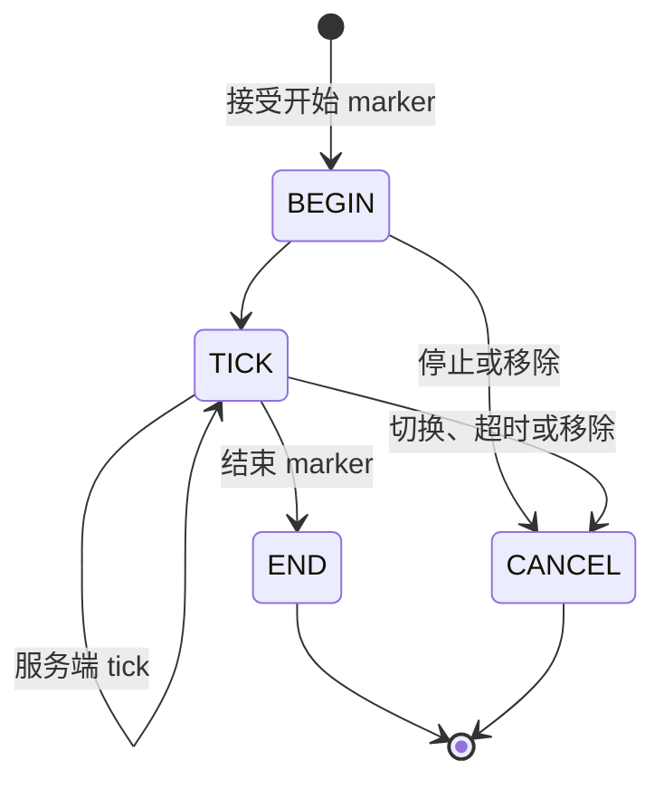

# 部位选择、碰撞与事件

[English](https://github.com/kltyton/KltytonBedrockRuntime/wiki/Collision-and-Events) | [简体中文](https://github.com/kltyton/KltytonBedrockRuntime/wiki/Collision-and-Events.zh-CN) · [首页](https://github.com/kltyton/KltytonBedrockRuntime/wiki/Home.zh-CN)

KBR 从已注册模型部位生成几何。注册用于选择参与处理的部位，不要求逐个手写 OBB 尺寸。

## 注册实体部位

为实体实现 `com.kltyton.bedrockruntime.api.entity.BoneHitboxEntity`，在已有实体类内部覆写注册方法：

```java
@Override
public void kltyton_bedrock_runtime$registerObbBones(ObbBoneRegistrar registrar) {
    registrar.register(ObbBoneRegistrar.ALL)
            .dataFactory(
                    ObbBoneRegistrar.ALL,
                    ObbBuiltinDataKeys.PART_HEALTH,
                    () -> new ObbPartHealth(20.0F, 20.0F));
    registrar.register("right_arm")
            .attack()
            .collision(ObbCollisionMode.HARD);
}
```

导入位置：

| 类型 | 包 |
| --- | --- |
| `ObbBoneRegistrar` | `com.kltyton.bedrockruntime.api.registration.registrar` |
| `ObbCollisionMode` | `com.kltyton.bedrockruntime.api.bone.collision` |
| `ObbBuiltinDataKeys` | `com.kltyton.bedrockruntime.api.data.builtin.key` |
| `ObbPartHealth` | `com.kltyton.bedrockruntime.api.data.builtin.health` |

使用模型中真实的骨骼名。`ALL` 选择全部捕获部位；`BASE` 选择标准人形身体部位；`HUMAN_BASE` 还包含持物。内置玩家接入使用 `HUMAN_BASE`，其他实体自行注册。空注册方法属于错误。

`dataFactory` 为每个选中部位创建独立值。此例让每个部位拥有独立生命值对象，并让右臂额外接入攻击接触及硬碰撞。

## 属性与碰撞策略

`ATTACK`、`HURT`、`COLLISION` 是可组合属性，不是互斥的碰撞箱类别。

| 碰撞模式 | 含义 |
| --- | --- |
| `NONE` | 接触/事件，不产生物理响应 |
| `SOFT` | 推挤响应 |
| `HARD` | OBB 位移裁剪与接触响应 |

运行时可改变永久属性或命名临时属性。动作结束或取消时应释放自己的临时作用域。

```java
ObbBoneState bone = entity.kltyton_bedrock_runtime$obbBone(key).orElseThrow();
bone.setTemporaryAttackBox("examplemod:slash", true);
bone.setTemporaryCollision("examplemod:barrier", ObbCollisionMode.HARD);
bone.clearTemporaryAttributes("examplemod:slash");
bone.clearTemporaryAttributes("examplemod:barrier");
```

此例中 `entity` 已实现接口，`key` 对应已注册、已发现的部位。`ObbBoneState` 位于 `api.state.runtime`。

## 选择与显示部位

客户端使用完成动画后的模型姿势。持物几何使用世界中的实际持物变换；第一人称也不会把屏幕覆盖层当作世界碰撞体。

准星 OBB 显示默认关闭，可在客户端配置中开启、绑定按住显示键位，或使用 F3+B。增强网格的射线选择可使用真实三角形，实体运动仍采用 OBB。

## 选择正确的事件

在模组初始化时注册一次监听器。例如在玩家原版受击事件后读取已更新的部位生命值：

```java
import com.kltyton.bedrockruntime.api.event.BoneHitboxEvents;
import com.kltyton.bedrockruntime.api.data.builtin.key.ObbBuiltinDataKeys;
import org.slf4j.LoggerFactory;

var log = LoggerFactory.getLogger("examplemod.parts");
BoneHitboxEvents.registerPlayerPartHurt(context ->
        context.hurtBone().getData(ObbBuiltinDataKeys.PART_HEALTH)
                .ifPresent(health -> log.debug("Part health: {}", health.health())));
```

内置部位生命值处理会扣除一次实际原版伤害，监听器可用这个值实现自己的视觉或玩法规则。

| 事件类别 | 注册入口示例 | 触发来源 |
| --- | --- | --- |
| 原版攻击/受击关联 | `registerPlayerPartAttack`、`registerEntityHurtBoxHurt` | 对应原版攻击/受击路径 |
| OBB 接触攻击/受击 | `registerPlayerObbCollisionAttack`、`registerEntityObbCollisionHurt` | 已注册 OBB 接触生命周期 |
| 交互 | `registerPlayerPartInteract`、`registerEntityPartInteract` | 部位交互 |
| 普通接触 | `registerPlayerPartCollision`、`registerEntityPartCollision` | 部位接触生命周期 |

攻击回调接收 `ObbAttackContext`，通过 `vanillaAttack()`、`obbContactAttack()` 或 `origin()` 区分原版伤害和纯接触。纯 OBB 接触不会由库额外调用一次原版伤害。

## 服务端查询几何

```java
var snapshot = ObbServerGeometry.snapshot(entity);
var hit = ObbServerGeometry.raycast(entity, from, to);
```

`ObbServerGeometry` 位于 `com.kltyton.bedrockruntime.api.geometry.query`。`entity` 是被查询实体，`from`/`to` 是世界空间 `Vec3` 线段端点。快照中的部位暴露骨骼状态、几何、边界、变换和世界顶点。

服务端查询的是近期客户端姿态。没有渲染上报者或超过 40 tick 新鲜度窗口时，快照可能不存在。服务端会校验追踪关系、注册键、有限变换、范围及上报预算；伤害、技能启动等玩法仍由使用方根据服务端状态授权。

需要服务端精确 `poly_mesh` 查询时，按[模型](https://github.com/kltyton/KltytonBedrockRuntime/wiki/Models.zh-CN)页面注册模型数据并绑定实体类型。

## 关键帧技能

`GeoKeyframeSkillEntity` 通过 `kltyton_bedrock_runtime$registerGeoKeyframeSkills` 注册单点 marker 或窗口。`GeoKeyframeSkillRegistrar.point` 对应单点，`window` 对应开始/结束 marker。



在已有 GeckoLib 自定义指令 handler 中追加 `GeoKeyframeSkillClientBridge.forward(event)`，保留原有处理。图的姿势采样不会替代 handler，也不会再派发一份相同事件。

多个追踪客户端的上报会在服务端去重。使用 `kltyton_bedrock_runtime$acceptGeoKeyframeSkill` 将开始 marker 与服务端技能状态对应；在 `END`、`CANCEL` 中释放自己持有的资源或临时组。

自定义 codec、上报者选择和完整关键帧上下文见[注册、同步与事件参考](https://github.com/kltyton/KltytonBedrockRuntime/blob/main/docs/server_sync_api.md)。
