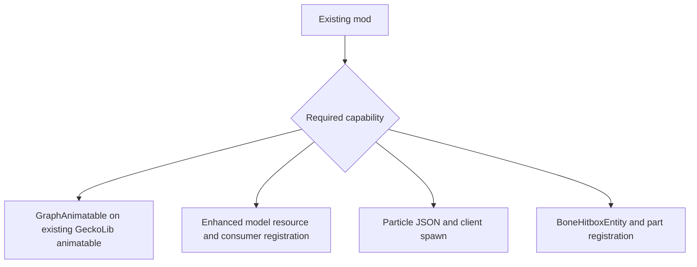

# Developer setup

[English](https://github.com/kltyton/KltytonBedrockRuntime/wiki/Getting-Started) | [简体中文](https://github.com/kltyton/KltytonBedrockRuntime/wiki/Getting-Started.zh-CN) · [Home](https://github.com/kltyton/KltytonBedrockRuntime/wiki/Home)

KBR's Maven group is `com.kltyton` and its Java package is `com.kltyton.bedrockruntime`. Version-specific code belongs in the adapter for that Minecraft/loader pair.

## Dependencies

For NeoForge 26.2:

```groovy
repositories {
    maven {
        url = 'https://maven.sighs.cc/repository/maven-public/'
        content {
            includeModule 'com.kltyton', 'kltyton_bedrock_runtime-common-26.2'
            includeModule 'com.kltyton', 'kltyton_bedrock_runtime-neoforge-26.2'
        }
    }
}

dependencies {
    compileOnly 'com.kltyton:kltyton_bedrock_runtime-common-26.2:0.4.0'
    runtimeOnly 'com.kltyton:kltyton_bedrock_runtime-neoforge-26.2:0.4.0'
}
```

Keep your existing loader and GeckoLib dependency setup, including GeckoLib's repository. For Fabric 1.20.1/1.21.1, use your Loom mod dependency configurations for the loader artifact. Fabric 26.x and NeoForge use the configurations selected by their target build plugins.

Common artifacts are compile-time API artifacts. Loader artifacts are installable mods. Substitute the Minecraft version and loader using the [coordinate table](https://github.com/kltyton/KltytonBedrockRuntime/blob/main/docs/versions/README.md).

Declare the runtime dependency in your mod metadata as well. KBR's mod ID is `kltyton_bedrock_runtime`.

## Resource layout

| Resource | GeckoLib 4 targets | GeckoLib 5 targets |
| --- | --- | --- |
| Model | `assets/examplemod/geo/actor.geo.json` | `assets/examplemod/geckolib/models/actor.geo.json` |
| Animation clips | `assets/examplemod/animations/actor.animation.json` | `assets/examplemod/geckolib/animations/actor.animation.json` |
| Particle definition | `assets/examplemod/particle_definitions/spark.json` | Same |
| Model-particle descriptor | `assets/examplemod/particle_models/spark_model.json` | Same |

Replace `examplemod` with your mod ID. Resource IDs passed to `EnhancedModels` contain the complete asset path, such as `examplemod:geckolib/models/actor.geo.json`.

## Choose an integration



- For animation, add `GraphAnimatable` to the class GeckoLib already animates. Preserve its native controllers and renderer. See [Animation graphs](https://github.com/kltyton/KltytonBedrockRuntime/wiki/Animation-Graphs).
- For enhanced geometry, register the resource during setup, then declare consumers before baking. Register server geometry bindings where you need trusted mesh lookup. See [Models](https://github.com/kltyton/KltytonBedrockRuntime/wiki/Models).
- For particles, supply the effect JSON and spawn it on the client or through the provided command. Keep client rendering classes in client code. See [Particles](https://github.com/kltyton/KltytonBedrockRuntime/wiki/Particles).
- For selection/collision, implement `BoneHitboxEntity` and register at least one selector. See [Collision and events](https://github.com/kltyton/KltytonBedrockRuntime/wiki/Collision-and-Events).

## Source examples

The [examples](https://github.com/kltyton/KltytonBedrockRuntime/tree/main/examples) source set contains authored model, graph and particle scenes. Run the appropriate target with `-Pdevelopment_examples` to include those examples in development. They are excluded from regular distribution JARs.

Build one target with its own Wrapper:

```powershell
cd .\targets\neoforge-26.2
.\gradlew.bat build
```

This is a build command, not a requirement to generate your hand-authored JSON resources.
