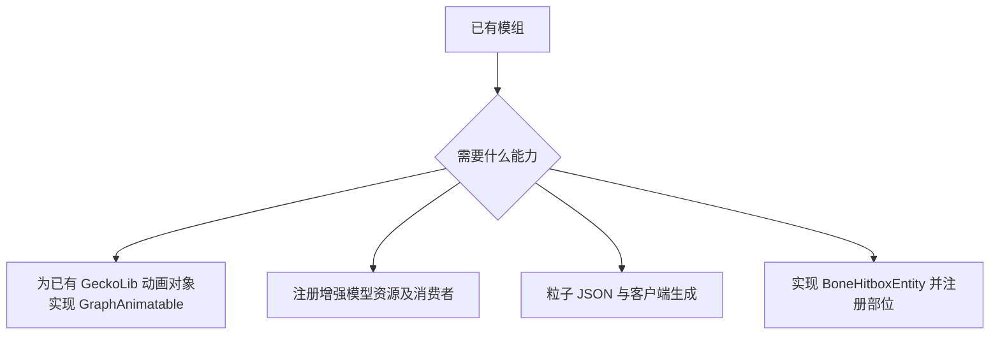

# 开发入门

[English](https://github.com/kltyton/KltytonBedrockRuntime/wiki/Getting-Started) | [简体中文](https://github.com/kltyton/KltytonBedrockRuntime/wiki/Getting-Started.zh-CN) · [首页](https://github.com/kltyton/KltytonBedrockRuntime/wiki/Home.zh-CN)

KBR 的 Maven 组为 `com.kltyton`，Java 包为 `com.kltyton.bedrockruntime`。版本专属代码应放在对应 Minecraft/加载器适配层。

## 添加依赖

以 NeoForge 26.2 为例：

```groovy
repositories {
    maven {
        url = 'https://maven.sighs.cc/repository/maven-public/'
        content {
            includeModule 'com.kltyton', 'kltyton_bedrock_runtime-common-26.2'
            includeModule 'com.kltyton', 'kltyton_bedrock_runtime-neoforge-26.2'
        }
    }
}

dependencies {
    compileOnly 'com.kltyton:kltyton_bedrock_runtime-common-26.2:0.4.0'
    runtimeOnly 'com.kltyton:kltyton_bedrock_runtime-neoforge-26.2:0.4.0'
}
```

保留已有加载器和 GeckoLib 的依赖配置及 GeckoLib 仓库。Fabric 1.20.1/1.21.1 的加载器产物应通过所在 Loom 工程的 mod 依赖配置接入；Fabric 26.x 和 NeoForge 使用各目标构建插件对应的配置。

common 产物提供编译期 API；加载器产物是可安装模组。其他版本与加载器按[坐标表](https://github.com/kltyton/KltytonBedrockRuntime/blob/main/docs/versions/README.zh-CN.md)替换。

还需在自己的模组元数据中声明运行依赖。KBR 的 modid 为 `kltyton_bedrock_runtime`。

## 资源目录

| 资源 | GeckoLib 4 目标 | GeckoLib 5 目标 |
| --- | --- | --- |
| 模型 | `assets/examplemod/geo/actor.geo.json` | `assets/examplemod/geckolib/models/actor.geo.json` |
| 动画片段 | `assets/examplemod/animations/actor.animation.json` | `assets/examplemod/geckolib/animations/actor.animation.json` |
| 粒子定义 | `assets/examplemod/particle_definitions/spark.json` | 相同 |
| 模型粒子描述 | `assets/examplemod/particle_models/spark_model.json` | 相同 |

将 `examplemod` 替换为自己的 modid。传给 `EnhancedModels` 的资源 ID 包含完整资源路径，例如 `examplemod:geckolib/models/actor.geo.json`。

## 选择接入点



- 动画：给 GeckoLib 已在驱动的对象添加 `GraphAnimatable`，保留原有控制器和渲染器。见[动画图](https://github.com/kltyton/KltytonBedrockRuntime/wiki/Animation-Graphs.zh-CN)。
- 增强几何：在初始化时注册资源，烘焙前声明消费者；需要服务端网格查询时注册实体与模型的绑定。见[模型](https://github.com/kltyton/KltytonBedrockRuntime/wiki/Models.zh-CN)。
- 粒子：提供效果 JSON，通过客户端 API 或命令生成；客户端渲染类保留在客户端代码中。见[粒子](https://github.com/kltyton/KltytonBedrockRuntime/wiki/Particles.zh-CN)。
- 选择与碰撞：实现 `BoneHitboxEntity`，至少注册一个选择器。见[碰撞与事件](https://github.com/kltyton/KltytonBedrockRuntime/wiki/Collision-and-Events.zh-CN)。

## 源码示例

[examples](https://github.com/kltyton/KltytonBedrockRuntime/tree/main/examples) 源集提供自制模型、动画图及粒子场景。为对应目标添加 `-Pdevelopment_examples` 可在开发环境加载；普通发行 JAR 不包含这些示例。

使用目标自己的 Wrapper 构建：

```powershell
cd .\targets\neoforge-26.2
.\gradlew.bat build
```

构建不要求把自己手写的 JSON 资源改为 DataGen。
