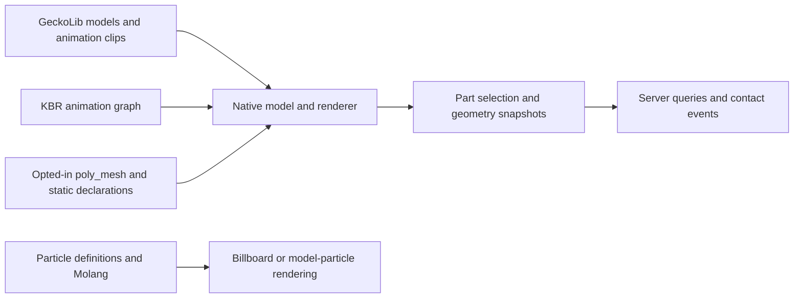

# Kltyton Bedrock Runtime Wiki

[English](https://github.com/kltyton/KltytonBedrockRuntime/wiki) | [简体中文](https://github.com/kltyton/KltytonBedrockRuntime/wiki/Home.zh-CN)

**Kltyton Bedrock Runtime (KBR)** extends GeckoLib with Bedrock model and particle runtime capabilities, animation composition, and model-part selection and collision. This Wiki documents KBR **0.4.0**.

## Choose your starting point

| You want to… | Read |
| --- | --- |
| Install a dependency for another mod | [Installation](https://github.com/kltyton/KltytonBedrockRuntime/wiki/Installation) |
| Add KBR to a mod project | [Getting started](https://github.com/kltyton/KltytonBedrockRuntime/wiki/Getting-Started) |
| Blend movement, aim and additive poses | [Animation graphs](https://github.com/kltyton/KltytonBedrockRuntime/wiki/Animation-Graphs) |
| Load polygon models or declare static geometry | [Models and poly_mesh](https://github.com/kltyton/KltytonBedrockRuntime/wiki/Models) |
| Create billboard and model particles | [Particles and Molang](https://github.com/kltyton/KltytonBedrockRuntime/wiki/Particles) |
| Register body parts, handle contacts or query hits | [Collision and events](https://github.com/kltyton/KltytonBedrockRuntime/wiki/Collision-and-Events) |
| Build model-derived block shapes | [Block geometry](https://github.com/kltyton/KltytonBedrockRuntime/wiki/Block-Geometry) |
| Resolve resource or integration mistakes | [FAQ](https://github.com/kltyton/KltytonBedrockRuntime/wiki/FAQ) |

## How the pieces fit

GeckoLib remains a required dependency. KBR does not embed another copy of it. Enhanced graphs and model declarations are opt-in; ordinary GeckoLib resource conventions remain in use.

Particles are client visual effects. Collision, damage and skill rules belong to the integrating mod's server logic. Register the geometry and interactions you actually intend to use.

## Project links

- [Source and issue tracker](https://github.com/kltyton/KltytonBedrockRuntime)
- [Complete API reference notes](https://github.com/kltyton/KltytonBedrockRuntime/tree/main/docs)
- [Development examples](https://github.com/kltyton/KltytonBedrockRuntime/tree/main/examples)
- [License](https://github.com/kltyton/KltytonBedrockRuntime/blob/main/LICENSE)
