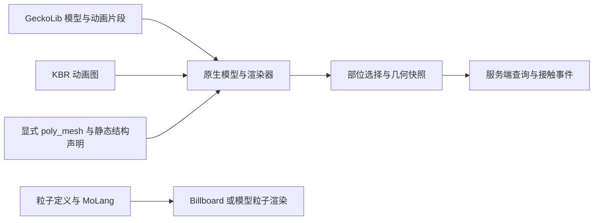

# Kltyton Bedrock Runtime 中文 Wiki

[English](https://github.com/kltyton/KltytonBedrockRuntime/wiki) | [简体中文](https://github.com/kltyton/KltytonBedrockRuntime/wiki/Home.zh-CN)

**Kltyton Bedrock Runtime（KBR）** 为 GeckoLib 扩展基岩版模型与粒子运行能力、动画组合，以及模型部位选择和碰撞。本 Wiki 对应 **0.4.0**。

## 从哪里开始

| 你的目标 | 页面 |
| --- | --- |
| 给其他模组安装前置 | [安装](https://github.com/kltyton/KltytonBedrockRuntime/wiki/Installation.zh-CN) |
| 在模组工程中接入 KBR | [开发入门](https://github.com/kltyton/KltytonBedrockRuntime/wiki/Getting-Started.zh-CN) |
| 混合移动、瞄准和增量动作 | [动画图](https://github.com/kltyton/KltytonBedrockRuntime/wiki/Animation-Graphs.zh-CN) |
| 使用多边形模型或声明静态结构 | [模型与 poly_mesh](https://github.com/kltyton/KltytonBedrockRuntime/wiki/Models.zh-CN) |
| 制作 Billboard 与模型粒子 | [粒子与 MoLang](https://github.com/kltyton/KltytonBedrockRuntime/wiki/Particles.zh-CN) |
| 注册部位、处理接触和射线查询 | [碰撞与事件](https://github.com/kltyton/KltytonBedrockRuntime/wiki/Collision-and-Events.zh-CN) |
| 从模型生成方块形状 | [方块几何](https://github.com/kltyton/KltytonBedrockRuntime/wiki/Block-Geometry.zh-CN) |
| 排查资源与接入问题 | [常见问题](https://github.com/kltyton/KltytonBedrockRuntime/wiki/FAQ.zh-CN) |

## 各部分怎样协作

GeckoLib 仍是必需依赖，KBR 不内嵌另一份 GeckoLib。增强图与模型声明由使用方显式启用，普通 GeckoLib 资源约定继续适用。

粒子是客户端视觉效果。碰撞、伤害与技能规则由接入模组的服务端逻辑决定；请注册实际需要参与处理的几何和交互。

## 项目资料

- [源码与问题反馈](https://github.com/kltyton/KltytonBedrockRuntime)
- [完整 API 参考说明](https://github.com/kltyton/KltytonBedrockRuntime/tree/main/docs)
- [开发示例](https://github.com/kltyton/KltytonBedrockRuntime/tree/main/examples)
- [许可证](https://github.com/kltyton/KltytonBedrockRuntime/blob/main/LICENSE)
