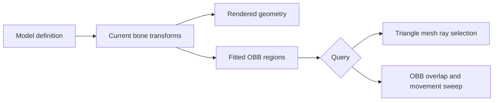

# Models, poly_mesh and static geometry

[English](https://github.com/kltyton/KltytonBedrockRuntime/wiki/Models) | [简体中文](https://github.com/kltyton/KltytonBedrockRuntime/wiki/Models.zh-CN) · [Home](https://github.com/kltyton/KltytonBedrockRuntime/wiki/Home)

Enhanced models remain GeckoLib models. Use the normal GeckoLib renderer, texture and animation setup, and add the KBR metadata only to resources that need it.

## A cube and polygon in one model

For GeckoLib 5, save this as `assets/examplemod/geckolib/models/prop.geo.json`. GeckoLib 4 uses `assets/examplemod/geo/prop.geo.json`. Supply the texture through your usual `GeoModel`.

```json
{
  "format_version": "1.12.0",
  "minecraft:geometry": [{
    "description": {
      "identifier": "geometry.examplemod.prop",
      "texture_width": 16,
      "texture_height": 16
    },
    "bones": [
      {
        "name": "body",
        "pivot": [0, 0, 0],
        "cubes": [{"origin": [-4, 0, -2], "size": [8, 8, 4], "uv": [0, 0]}]
      },
      {
        "name": "panel",
        "parent": "body",
        "pivot": [0, 8, 2],
        "poly_mesh": {
          "normalized_uvs": true,
          "positions": [[4, 8, 3], [4, 0, 3], [-4, 0, 3], [-4, 8, 3]],
          "normals": [[0, 0, 1]],
          "uvs": [[1, 1], [1, 0], [0, 0], [0, 1]],
          "polys": [[[0, 0, 0], [1, 0, 1], [2, 0, 2], [3, 0, 3]]]
        }
      }
    ]
  }],
  "kltyton_bedrock_runtime": {
    "format_version": 1,
    "model_mode": "tree",
    "double_sided": true
  }
}
```

Each polygon vertex is `[positionIndex, normalIndex, uvIndex]`. The three arrays can be indexed independently. Positions and pivots use authored Bedrock model coordinates; do not pre-apply KBR's X mirroring or divide them by 16. The adapter performs those conversions and the normalized V-coordinate flip.

`normalized_uvs: true` means authored UVs are already in 0..1. Otherwise UVs are normalized using texture dimensions. Simple planar polygons, including concave polygons, are accepted; concave polygons use ear clipping. Holes, self-intersections, nonplanar faces, invalid indices and non-finite coordinates produce resource/bone diagnostics.

`double_sided` is a model declaration for emitted mesh faces. Choose it deliberately for thin surfaces; it does not disable culling globally.

## Register the model and its consumers

Run resource registration during your mod's setup. For example, this method uses the calling class to locate a packaged model:

```java
import com.kltyton.bedrockruntime.api.model.EnhancedModels;
import com.kltyton.bedrockruntime.model.binding.ModelConsumer;
import com.kltyton.bedrockruntime.model.binding.ModelConsumers;
import net.minecraft.world.entity.EntityType;

public final class PropModels {
    public static final String MODEL =
            "examplemod:geckolib/models/prop.geo.json";

    public static void register(EntityType<?> entityType) {
        EnhancedModels.registerResource(MODEL, PropModels.class);
        EnhancedModels.registerConsumers(MODEL, ModelConsumers.builder()
                .add(ModelConsumer.PROCEDURAL, "panel")
                .build());
        EnhancedModels.bindEntity(entityType, MODEL);
    }

    private PropModels() { }
}
```

Use your own mod ID and the full target-specific resource path. Register before the model is baked. The example marks `panel` as a programmatic consumer, so static compilation must preserve its dynamic access.

Register server-side resource data and the entity binding when exact server mesh lookup is needed. `bindEntity` also accepts an entity-to-resource resolver for models selected from authoritative entity state. Every returned resource must already be registered.

## Tree and Baked modes

| Declaration | Behavior |
| --- | --- |
| `model_mode: "tree"` | Keep the native bone tree, cubes and attached mesh geometry |
| `model_mode: "baked"` | Permit certified static groups to compile together |
| `static_bones` | Explicitly certify named bones as static |
| `preserve_bones` | Keep named bones on the original logical path |
| `double_sided` | Select double-sided mesh faces for this model |

For a genuinely static version of the two-bone prop:

```json
{
  "format_version": 1,
  "model_mode": "baked",
  "static_bones": ["body", "panel"],
  "preserve_bones": [],
  "double_sided": true
}
```

This object replaces the model's `kltyton_bedrock_runtime` property. Do not certify a bone that an animation, Java adjustment, mask, locator, held item, armor layer or per-bone callback needs. Declare those consumers with `ModelConsumers` or preserve the bone explicitly.

Compilation needs at least two geometry-bearing bones within an eligible static group. A group that cannot meet the static and consumer rules keeps its native geometry path. Baked mode is a geometry organization option, not a promise to remove all bone processing.

## Inline animation graphs

A model can include a versioned graph in `kltyton_bedrock_runtime.graph`:

```json
{
  "format_version": 1,
  "model_mode": "tree",
  "graph": {
    "version": 1,
    "output": "idle",
    "nodes": {
      "idle": {"type": "animation", "animation": "idle", "time": "loop"}
    }
  }
}
```

Return `EnhancedModels.graph(MODEL)` from your existing animatable's `animationGraph()`. The client resolves the graph from the current baked model, so a resource reload uses the matching model generation. See [Animation graphs](https://github.com/kltyton/KltytonBedrockRuntime/wiki/Animation-Graphs).

## Geometry and gameplay



An enhanced mesh can participate in precise ray and part-selection queries. Entity movement remains an OBB collision path. Registering a rendered model alone does not authorize a server gameplay action; use the appropriate entity/part contracts in [Collision and events](https://github.com/kltyton/KltytonBedrockRuntime/wiki/Collision-and-Events).

The [extension reference](https://github.com/kltyton/KltytonBedrockRuntime/blob/main/docs/animation/extensions.md) covers the neutral model/pose types and static-group rules.
