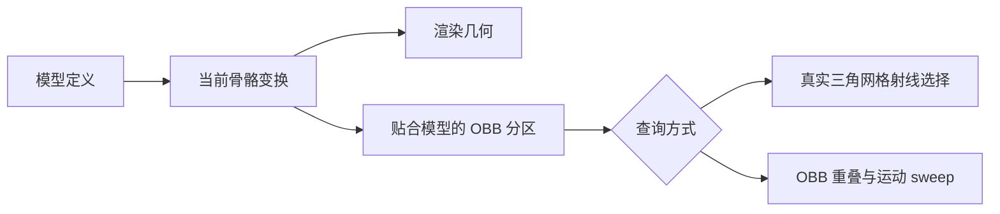

# 模型、poly_mesh 与静态几何

[English](https://github.com/kltyton/KltytonBedrockRuntime/wiki/Models) | [简体中文](https://github.com/kltyton/KltytonBedrockRuntime/wiki/Models.zh-CN) · [首页](https://github.com/kltyton/KltytonBedrockRuntime/wiki/Home.zh-CN)

增强模型仍是 GeckoLib 模型。保留普通 GeckoLib 渲染器、贴图和动画设置，只为需要扩展的资源增加 KBR 声明。

## 同一模型中的 cube 与多边形

GeckoLib 5 将下面资源保存为 `assets/examplemod/geckolib/models/prop.geo.json`；GeckoLib 4 使用 `assets/examplemod/geo/prop.geo.json`。贴图仍通过自己的 `GeoModel` 提供。

```json
{
  "format_version": "1.12.0",
  "minecraft:geometry": [{
    "description": {
      "identifier": "geometry.examplemod.prop",
      "texture_width": 16,
      "texture_height": 16
    },
    "bones": [
      {
        "name": "body",
        "pivot": [0, 0, 0],
        "cubes": [{"origin": [-4, 0, -2], "size": [8, 8, 4], "uv": [0, 0]}]
      },
      {
        "name": "panel",
        "parent": "body",
        "pivot": [0, 8, 2],
        "poly_mesh": {
          "normalized_uvs": true,
          "positions": [[4, 8, 3], [4, 0, 3], [-4, 0, 3], [-4, 8, 3]],
          "normals": [[0, 0, 1]],
          "uvs": [[1, 1], [1, 0], [0, 0], [0, 1]],
          "polys": [[[0, 0, 0], [1, 0, 1], [2, 0, 2], [3, 0, 3]]]
        }
      }
    ]
  }],
  "kltyton_bedrock_runtime": {
    "format_version": 1,
    "model_mode": "tree",
    "double_sided": true
  }
}
```

每个多边形顶点为 `[位置索引, 法线索引, UV索引]`，三个数组可以独立索引。顶点和 pivot 使用制作时的 Bedrock 模型坐标，不要预先应用 KBR 的 X 镜像或除以 16；适配层会完成这些转换及归一化后的 V 翻转。

`normalized_uvs: true` 表示 UV 已在 0..1 内，否则按贴图宽高归一化。接受简单平面多边形，包括使用耳切法处理的凹多边形。孔洞、自交、非平面面片、非法索引和非有限坐标会给出包含资源与骨骼的诊断。

`double_sided` 为该模型的网格面选择双面路径，可用于明确需要双面的薄片；它不会全局关闭背面剔除。

## 注册模型与消费者

在模组初始化阶段注册资源。下面的方法使用所在类读取已打包模型：

```java
import com.kltyton.bedrockruntime.api.model.EnhancedModels;
import com.kltyton.bedrockruntime.model.binding.ModelConsumer;
import com.kltyton.bedrockruntime.model.binding.ModelConsumers;
import net.minecraft.world.entity.EntityType;

public final class PropModels {
    public static final String MODEL =
            "examplemod:geckolib/models/prop.geo.json";

    public static void register(EntityType<?> entityType) {
        EnhancedModels.registerResource(MODEL, PropModels.class);
        EnhancedModels.registerConsumers(MODEL, ModelConsumers.builder()
                .add(ModelConsumer.PROCEDURAL, "panel")
                .build());
        EnhancedModels.bindEntity(entityType, MODEL);
    }

    private PropModels() { }
}
```

使用自己的 modid 和目标版本对应的完整资源路径，在模型烘焙前注册。此例将 `panel` 声明为程序控制消费者，静态合并时必须保留它的动态访问。

需要服务端精确网格查询时，在服务端也注册模型资源数据与实体绑定。`bindEntity` 还接受从实体解析资源的函数，便于按服务端实体状态选择模型；它返回的资源必须已经注册。

## Tree 与 Baked

| 声明 | 行为 |
| --- | --- |
| `model_mode: "tree"` | 保留原生骨骼树、cubes 与附着网格 |
| `model_mode: "baked"` | 允许已证明静态的分组合并几何 |
| `static_bones` | 显式证明这些骨骼可按静态结构处理 |
| `preserve_bones` | 让指定骨骼留在原有逻辑路径 |
| `double_sided` | 为当前模型选择双面网格 |

如果这个两骨骼摆件确实完全静态，可使用：

```json
{
  "format_version": 1,
  "model_mode": "baked",
  "static_bones": ["body", "panel"],
  "preserve_bones": [],
  "double_sided": true
}
```

此对象替换模型的 `kltyton_bedrock_runtime` 属性。动画、Java 调整、Mask、Locator、持物、盔甲层或逐骨骼回调需要的骨骼，不应被证明为无消费者的静态骨骼；使用 `ModelConsumers` 声明用途，或显式保留。

合并需要满足条件的静态组中至少有两根携带几何的骨骼。无法满足静态与消费者规则的分组继续使用原生几何路径。Baked 是几何组织方式，不代表可以去掉全部骨骼处理。

## 模型内联动画图

可在 `kltyton_bedrock_runtime.graph` 中放入带版本号的动画图：

```json
{
  "format_version": 1,
  "model_mode": "tree",
  "graph": {
    "version": 1,
    "output": "idle",
    "nodes": {
      "idle": {"type": "animation", "animation": "idle", "time": "loop"}
    }
  }
}
```

在已有动画对象的 `animationGraph()` 中返回 `EnhancedModels.graph(MODEL)`。客户端从当前烘焙模型解析该图，资源重载后会使用对应的模型代次。见[动画图](https://github.com/kltyton/KltytonBedrockRuntime/wiki/Animation-Graphs.zh-CN)。

## 几何与玩法



增强网格可参与精确射线和部位选择；实体运动碰撞仍使用 OBB。只注册渲染模型并不等于授权服务端玩法动作，应按[碰撞与事件](https://github.com/kltyton/KltytonBedrockRuntime/wiki/Collision-and-Events.zh-CN)中的实体与部位契约接入。

平台无关的模型/姿势类型及静态分组规则见[完整扩展说明](https://github.com/kltyton/KltytonBedrockRuntime/blob/main/docs/animation/extensions.md)。
