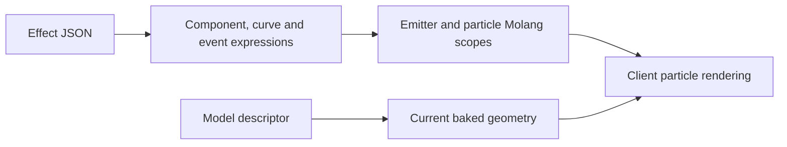

# Particles and Molang

[English](https://github.com/kltyton/KltytonBedrockRuntime/wiki/Particles) | [简体中文](https://github.com/kltyton/KltytonBedrockRuntime/wiki/Particles.zh-CN) · [Home](https://github.com/kltyton/KltytonBedrockRuntime/wiki/Home)

KBR reads Bedrock-style particle definitions from ordinary client resources. It includes the particle runtime, not a visual particle editor.

## Resource paths

| Purpose | Path |
| --- | --- |
| Effect definition | `assets/examplemod/particle_definitions/spark.json` |
| Model-particle descriptor | `assets/examplemod/particle_models/gem.json` |
| Cube model for a geometry descriptor | `assets/examplemod/models/particle/gem.json` |

These are normal authored resources. They do not require DataGen. Use your own namespace and provide every referenced texture/model.

## A billboard effect

Save the following as `particle_definitions/spark.json`:

```json
{
  "format_version": "1.10.0",
  "particle_effect": {
    "description": {
      "identifier": "examplemod:spark",
      "basic_render_parameters": {
        "material": "particles_alpha",
        "texture": "minecraft:particle/generic_0"
      }
    },
    "components": {
      "minecraft:emitter_rate_steady": {"spawn_rate": 8, "max_particles": 24},
      "minecraft:emitter_lifetime_looping": {"active_time": 2.0, "sleep_time": 1.0},
      "minecraft:emitter_shape_sphere": {
        "radius": 0.5,
        "direction": "outwards",
        "surface_only": false
      },
      "minecraft:particle_lifetime_expression": {
        "max_lifetime": "math.random(0.8, 1.6)"
      },
      "minecraft:particle_initial_speed": "math.random(0.05, 0.25)",
      "minecraft:particle_motion_dynamic": {
        "linear_acceleration": [0.0, 0.35, 0.0],
        "linear_drag_coefficient": 1.5
      },
      "minecraft:particle_appearance_billboard": {
        "size": [0.12, "0.12 + math.sin(variable.particle_age * 360) * 0.03"],
        "facing_camera_mode": "lookat_xyz",
        "uv": {
          "texture_width": 8,
          "texture_height": 8,
          "uv": [0, 0],
          "uv_size": [8, 8]
        }
      }
    }
  }
}
```

This effect emits eight particles per second within a sphere, applies upward acceleration and changes billboard height with a Molang expression.

After the resource is loaded, an administrator can preview it with:

```text
/kltyton_bedrock_runtime add examplemod:spark ~ ~1 ~
```

## Client API

In your client code on 26.2:

```java
import com.kltyton.bedrockruntime.client.particle.runtime.MolangParticleOption;
import net.minecraft.client.Minecraft;
import net.minecraft.client.multiplayer.ClientLevel;
import net.minecraft.resources.Identifier;

public final class SparkEffects {
    public static void spawn(double x, double y, double z) {
        ClientLevel level = Minecraft.getInstance().level;
        if (level != null) {
            level.addParticle(new MolangParticleOption(
                    Identifier.fromNamespaceAndPath("examplemod", "spark")),
                    x, y, z, 0.0, 0.0, 0.0);
        }
    }

    private SparkEffects() { }
}
```

Invoke this through your client-side gameplay or visual flow. On 1.20.1 use `new ResourceLocation(namespace, path)`; on 1.21.1 use `ResourceLocation.fromNamespaceAndPath`. Keep client classes out of common/server initialization.

## Turn the effect into model particles

Copy the billboard effect to `particle_definitions/gem_dust.json`. Within `particle_effect`:

1. Change `description.identifier` to `examplemod:gem_dust`.
2. Set `description.type` to `kltyton_bedrock_runtime:model_particle`.
3. Replace the billboard appearance component with `kltyton_bedrock_runtime:model_appearance`. Keep the lifetime, shape, emission and motion components.

The changed fields are:

```json
{
  "description": {
    "identifier": "examplemod:gem_dust",
    "type": "kltyton_bedrock_runtime:model_particle"
  },
  "components": {
    "kltyton_bedrock_runtime:model_appearance": {
      "size": [0.35, 0.35, 0.35],
      "facing_camera_mode": "lookat_xyz",
      "model": "examplemod:gem"
    }
  }
}
```

Save this descriptor as `particle_models/gem.json`:

```json
{
  "variant": "geometry",
  "model_id": "examplemod:particle/gem",
  "texture": "minecraft:block/amethyst_block",
  "material": "cutout",
  "double_sided": false
}
```

Save the cube geometry as `models/particle/gem.json`:

```json
{
  "textures": {"all": "minecraft:block/amethyst_block"},
  "elements": [{
    "from": [5, 5, 5],
    "to": [11, 11, 11],
    "faces": {
      "down": {"uv": [0, 0, 16, 16], "texture": "#all"},
      "up": {"uv": [0, 0, 16, 16], "texture": "#all"},
      "north": {"uv": [0, 0, 16, 16], "texture": "#all"},
      "south": {"uv": [0, 0, 16, 16], "texture": "#all"},
      "west": {"uv": [0, 0, 16, 16], "texture": "#all"},
      "east": {"uv": [0, 0, 16, 16], "texture": "#all"}
    }
  }]
}
```

The descriptor's `model_id` resolves the model path; `model_appearance.model` selects the descriptor. For model particles, the descriptor supplies the texture sprite and material.

| Descriptor variant | Geometry source |
| --- | --- |
| `geometry` | Ordinary cube-model JSON |
| `geckolib` | An available baked GeckoLib model |
| `poly_mesh` | A baked enhanced GeckoLib model carrying mesh geometry |
| `hardcode` | A registered vanilla model layer; `#layer` selects a non-default layer |

Materials are `solid`, `cutout`, `cutout_mipped` and `translucent`. `double_sided` controls emitted faces. GeckoLib-backed models must be available in the baked model cache when the descriptor is resolved.

## Molang and reloads



Particle expressions use KBR's particle-context Molang runtime. GeckoLib animation and model expressions continue to use GeckoLib's own evaluator. Variables from one context do not become global variables in the other.

`F3+T` prepares definitions and model descriptors, then publishes the new resource snapshot on the game thread. Programmatic `ModelParticleModels.register(id, model)` registrations survive resource reloads.

Particles are visual objects; a model-particle appearance does not create a server entity, a damage source or an entity movement collider. Use [Collision and events](https://github.com/kltyton/KltytonBedrockRuntime/wiki/Collision-and-Events) for gameplay geometry.

The [particle reference](https://github.com/kltyton/KltytonBedrockRuntime/blob/main/docs/animation/extensions.md#particle-runtime-and-model-particles) describes model frame selection and programmatic registration.
