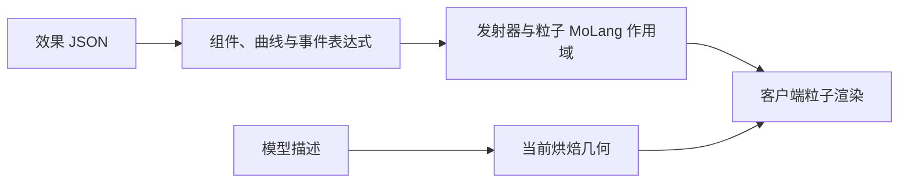

# 粒子与 MoLang

[English](https://github.com/kltyton/KltytonBedrockRuntime/wiki/Particles) | [简体中文](https://github.com/kltyton/KltytonBedrockRuntime/wiki/Particles.zh-CN) · [首页](https://github.com/kltyton/KltytonBedrockRuntime/wiki/Home.zh-CN)

KBR 从普通客户端资源读取基岩风格的粒子定义，提供粒子运行能力，不包含可视化粒子编辑器。

## 资源路径

| 用途 | 路径 |
| --- | --- |
| 效果定义 | `assets/examplemod/particle_definitions/spark.json` |
| 模型粒子描述 | `assets/examplemod/particle_models/gem.json` |
| geometry 描述引用的 cube 模型 | `assets/examplemod/models/particle/gem.json` |

这些都是作者维护的普通资源，不要求 DataGen。使用自己的命名空间，并提供所有引用的贴图和模型。

## Billboard 效果

将下面内容保存为 `particle_definitions/spark.json`：

```json
{
  "format_version": "1.10.0",
  "particle_effect": {
    "description": {
      "identifier": "examplemod:spark",
      "basic_render_parameters": {
        "material": "particles_alpha",
        "texture": "minecraft:particle/generic_0"
      }
    },
    "components": {
      "minecraft:emitter_rate_steady": {"spawn_rate": 8, "max_particles": 24},
      "minecraft:emitter_lifetime_looping": {"active_time": 2.0, "sleep_time": 1.0},
      "minecraft:emitter_shape_sphere": {
        "radius": 0.5,
        "direction": "outwards",
        "surface_only": false
      },
      "minecraft:particle_lifetime_expression": {
        "max_lifetime": "math.random(0.8, 1.6)"
      },
      "minecraft:particle_initial_speed": "math.random(0.05, 0.25)",
      "minecraft:particle_motion_dynamic": {
        "linear_acceleration": [0.0, 0.35, 0.0],
        "linear_drag_coefficient": 1.5
      },
      "minecraft:particle_appearance_billboard": {
        "size": [0.12, "0.12 + math.sin(variable.particle_age * 360) * 0.03"],
        "facing_camera_mode": "lookat_xyz",
        "uv": {
          "texture_width": 8,
          "texture_height": 8,
          "uv": [0, 0],
          "uv_size": [8, 8]
        }
      }
    }
  }
}
```

此效果在球形范围中每秒发射八个粒子，施加向上加速度，并通过 MoLang 改变 Billboard 高度。

资源加载后，管理员可以预览：

```text
/kltyton_bedrock_runtime add examplemod:spark ~ ~1 ~
```

## 客户端 API

以下示例对应 26.2，放在自己的客户端代码中：

```java
import com.kltyton.bedrockruntime.client.particle.runtime.MolangParticleOption;
import net.minecraft.client.Minecraft;
import net.minecraft.client.multiplayer.ClientLevel;
import net.minecraft.resources.Identifier;

public final class SparkEffects {
    public static void spawn(double x, double y, double z) {
        ClientLevel level = Minecraft.getInstance().level;
        if (level != null) {
            level.addParticle(new MolangParticleOption(
                    Identifier.fromNamespaceAndPath("examplemod", "spark")),
                    x, y, z, 0.0, 0.0, 0.0);
        }
    }

    private SparkEffects() { }
}
```

通过已有客户端玩法或视觉流程调用。1.20.1 使用 `new ResourceLocation(namespace, path)`，1.21.1 使用 `ResourceLocation.fromNamespaceAndPath`。客户端类不应由 common/服务端初始化路径引用。

## 改为模型粒子

将 Billboard 效果复制为 `particle_definitions/gem_dust.json`。在 `particle_effect` 内：

1. 将 `description.identifier` 改为 `examplemod:gem_dust`。
2. 将 `description.type` 设置为 `kltyton_bedrock_runtime:model_particle`。
3. 用 `kltyton_bedrock_runtime:model_appearance` 替换 Billboard 外观组件；保留生命周期、形状、发射和运动组件。

修改的字段如下：

```json
{
  "description": {
    "identifier": "examplemod:gem_dust",
    "type": "kltyton_bedrock_runtime:model_particle"
  },
  "components": {
    "kltyton_bedrock_runtime:model_appearance": {
      "size": [0.35, 0.35, 0.35],
      "facing_camera_mode": "lookat_xyz",
      "model": "examplemod:gem"
    }
  }
}
```

描述文件保存为 `particle_models/gem.json`：

```json
{
  "variant": "geometry",
  "model_id": "examplemod:particle/gem",
  "texture": "minecraft:block/amethyst_block",
  "material": "cutout",
  "double_sided": false
}
```

cube 几何保存为 `models/particle/gem.json`：

```json
{
  "textures": {"all": "minecraft:block/amethyst_block"},
  "elements": [{
    "from": [5, 5, 5],
    "to": [11, 11, 11],
    "faces": {
      "down": {"uv": [0, 0, 16, 16], "texture": "#all"},
      "up": {"uv": [0, 0, 16, 16], "texture": "#all"},
      "north": {"uv": [0, 0, 16, 16], "texture": "#all"},
      "south": {"uv": [0, 0, 16, 16], "texture": "#all"},
      "west": {"uv": [0, 0, 16, 16], "texture": "#all"},
      "east": {"uv": [0, 0, 16, 16], "texture": "#all"}
    }
  }]
}
```

描述文件的 `model_id` 解析模型路径，`model_appearance.model` 选择描述文件。模型粒子的贴图 sprite 与材质由描述文件提供。

| 描述类型 | 几何来源 |
| --- | --- |
| `geometry` | 普通 cube 模型 JSON |
| `geckolib` | 已有的烘焙 GeckoLib 模型 |
| `poly_mesh` | 携带增强网格的烘焙 GeckoLib 模型 |
| `hardcode` | 已注册的原版模型层；可通过 `#layer` 指定非默认层 |

材质支持 `solid`、`cutout`、`cutout_mipped`、`translucent`。`double_sided` 控制输出面的双面行为。使用 GeckoLib 模型时，对应模型需要在解析描述文件时已存在于烘焙缓存。

## MoLang 与重载



粒子表达式由 KBR 的粒子上下文 MoLang 运行时求值；GeckoLib 模型和动画表达式继续由自身引擎计算，一个上下文中的变量不会自动变成另一个上下文的全局变量。

`F3+T` 准备新的定义与模型描述，再在游戏线程发布新资源快照。通过 `ModelParticleModels.register(id, model)` 注册的程序化模型会跨资源重载保留。

粒子是视觉对象；模型粒子的外观不会创建服务端实体、伤害源或实体运动碰撞体。玩法几何应通过[碰撞与事件](https://github.com/kltyton/KltytonBedrockRuntime/wiki/Collision-and-Events.zh-CN)接入。

模型帧选择和程序化注册详见[粒子参考](https://github.com/kltyton/KltytonBedrockRuntime/blob/main/docs/animation/extensions.md#particle-runtime-and-model-particles)。
