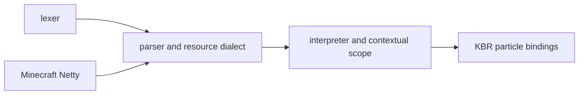

# mochafloats source integration

KBR builds the lexer, parser and interpreter from the pinned mochafloats 6.1.1 source artifacts. The modules target Java 17 and are nested in each loader JAR. The Minecraft target's Java version remains unchanged. The derived modules use the isolated group and package `com.kltyton.bedrockruntime.internal.mochafloats`, so they do not share coordinates or class names with upstream mochafloats.



## Source artifacts

Repository: [Redlance Maven](https://repo.redlance.org/public). Source: [PlayerAnimationLibrary/mochafloats](https://github.com/PlayerAnimationLibrary/mochafloats/tree/dcccb30261b5c06e4958c8566f13300032dfbec5).

| Module | Upstream coordinate | Source JAR SHA-256 |
| --- | --- | --- |
| lexer | `org.redlance.mochafloats:lexer:6.1.1:sources` | `9acaab7d8817611906220e99ae8804a93dbed6f796fcc5c30d779607c59ec9a6` |
| parser | `org.redlance.mochafloats:parser:6.1.1:sources` | `50e2af411b262e81c9fdb676086d4523e9946160c555cb35edc8e1b5a140d86e` |
| runtime | `org.redlance.mochafloats:runtime:6.1.1:sources` | `515a69a979c99ed220369f6bfcdcbc6ff4068e72ad024ff53715e741855241a8` |

The derived module version is `6.1.1-kbr.1` and its group is `com.kltyton.bedrockruntime.internal.mochafloats`. The upstream `org.redlance.mocha.{lexer,parser,runtime}` sources are relocated at build time to `com.kltyton.bedrockruntime.internal.mochafloats.{lexer,parser,runtime}`; these modules never emit an `org.redlance.mocha` class. This keeps the derived classes separate from the upstream artifacts that other mods may bundle. The Java 24 upstream binary artifacts and bytecode compiler are not runtime dependencies.

## Build integration

Each target includes `:mochafloatsLexer`, `:mochafloatsParser` and `:mochafloatsRuntime`. The common code compiles against the runtime module. Fabric uses Loom's nested dependencies; Forge and NeoForge use Jar-in-Jar. These private source-build modules are delivered inside the mod JAR and are not declared as external runtime dependencies.

The build verifies the pinned source JAR checksum, extracts it, applies the exact patches against the original `org/...` paths, adds the KBR support sources, and only then rewrites package declarations, imports, fully qualified names and source paths into the isolated package. Relocation is the final step, so patch anchors stay anchored to upstream text. The module's own `src/main/java` support classes are part of the same relocation and are compiled once from the relocated source tree.

Netty is compile-only, using the 1.20.1 host API baseline `4.1.82.Final`. Minecraft supplies Netty at runtime. Annotation dependencies are compile-only as well.

## Source adaptations

- `ParserDialect` selects operator precedence and conditional association using a particle resource's engine version.
- Numeric remainder and power preserve particle expression syntax.
- `ContextualScope` binds instance variables, structures, queries, actor references and lazy host functions.
- Contextual script evaluation has one return boundary. Arrows and nested blocks share it; loops consume their own break and continue signals.
- Missing values, empty arrays, array writes and snapshot iteration have explicit behavior.
- Ordinary upstream scopes retain their existing binding and evaluation path.

KBR's particle adapter lives in `client.particle.definition.molang.compat.mochafloats.v611`. GeckoLib continues to evaluate its native animation expressions through its own engine.

## Patches

The build checks each source JAR against the pinned digest, extracts it and applies exact source anchors before relocation. Patch files under `patches/<module>` use:

```text
artifact: runtime
upstream: 6.1.1
file: org/redlance/mocha/runtime/ExpressionInterpreter.java
<<<<<<< SOURCE
exact upstream text
=======
adapted text
>>>>>>> REPLACEMENT
```

Each source anchor must match exactly once. The `file:` anchors and their `org/redlance/mocha/...` paths refer to the upstream layout and are never rewritten. Additional Java sources use the module's normal `src/main/java` tree or `patches/<module>/support`; support files cannot overwrite upstream source files. Both trees are merged into the relocated output, which is the only Java source set compiled.

The original MIT notice is included. KBR's integration additions and patches use the repository's LGPL-3.0-only license; the required license texts accompany these modules.
